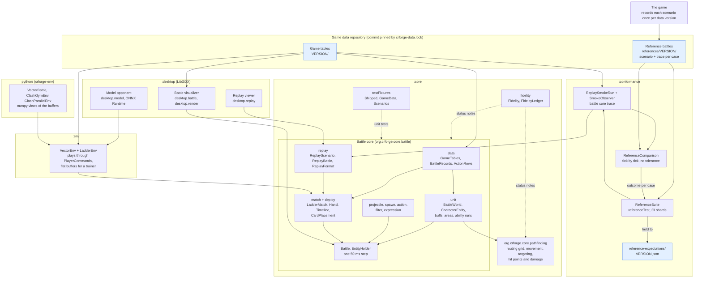

# crforge -- Architecture Overview

crforge is a deterministic Clash Royale battle simulator. Its engine, the battle core (`org.crforge.core.battle`), plays a battle in steps of 50 ms of game time, 20 steps a second, on the game's own tables of one data version, and the `conformance` module holds it tick by tick to battles recorded in the game. The same inputs on the same tables give the same battle, step for step.

This page is the index of the docs, the module and package layout, and the debug visualizer's reference.

---

## Documentation Map

| Document | Description |
|----------|-------------|
| [The Battle Core](battle-core.md) | The engine: its package layout, one step and the entity tick, when a player's command runs, the tests and the game data, what is covered, the roadmap and the assumptions carried |
| [Troop Pathfinding](pathfinding.md) | The movement, targeting and state rules the battle core runs: the routing grid, cell costs, the route search, endpoints and lanes, assumptions and what is still unvalidated |
| [Game Tables and Reference Battles](game-tables.md) | The game tables the battle core reads, how they are named, the recorded reference battles and the records built from the rows |
| [Conformance](../conformance/README.md) | How a reference battle is checked, the four outcomes and the expectations file, the coverage score and what it costs, moving to a new data version |
| [Compatibility](compatibility.md) | The client the simulator follows, the client versions that share its battle rules, and the data it runs |
| [Game Versions](game-versions.md) | Which data versions each game client version has run |
| [Performance](performance.md) | The headless tick benchmark (`:conformance:tickBenchmark`, JMH), what it measures, how to profile and the current baseline |
| [Performance History](performance-history.md) | The earlier benchmark baselines and each round of optimisations, with their numbers and profiles |
| [The Environment](environment.md) | The reinforcement learning environment on the battle core: the observation schema, the action space and mask, the faults, the vector environment and its benchmark, and the Python package on it |
| [Debug Visualizer](#debug-visualizer) | Below: the debug screen, the game tables it opens, its controls, the replay viewer and the overlays |

---

## Module Structure

```
crforge/
  core/           The battle core: headless, no GUI dependencies
  desktop/        LibGDX debug visualizer and replay viewer, on the battle core; plays a trained model through env
  conformance/    Checks the battle core against recorded reference battles
  env/            The reinforcement learning environment: a vector of battles behind flat buffers
  tables/         The table decoder: builds the game tables of a data version from the game's files
  python/         The crforge-env Python package on the env module's jars (not a Gradle module)
```

`conformance` and `env` depend on `core` only. `desktop` depends on `core` and on `env`, whose environment builds a model opponent's observation and takes its actions as in training, and on ONNX Runtime, which runs the model (see [Playing against a model](#playing-against-a-model)). Nothing depends on `desktop` or `conformance`. `tables` depends on nothing in the project. The game tables and the reference battles are not in this repository: they live in the game data repository, at the commit `crforge-data.lock` names, one folder per data version (see [Game Tables and Reference Battles](game-tables.md)).



### Core Package Layout

```
org.crforge.core/
  battle/        The battle core: Battle, BattleCommand, EntityHolder, HolderPasses, BattleRandom, TargetLocks
    action/        The action runtime and the action classes the game's action rows name
    data/          GameTables, GameRow, GameVersions, BattleRecords, ActionRows: the game's rows read once
    deploy/        CardPlacement: the map check, the placement search, the formation, the initial delay
    expression/    ExpressionCompiler, ExpressionEvaluator: the data's expression columns
    filter/        The game object filters
    match/         LadderMatch, MatchSide, Hand, Timeline, DeckShuffle: the mode, elixir and hands
    projectile/    ProjectileEntity, ProjectileLauncher, ProjectileFlight
    replay/        ReplayScenario, ReplayBattle, CommandTypes, ReplayFormat: replays as battles;
                   ScenarioWriter: a battle written as a replay
    spawn/         Character, area effect and projectile spawns
    unit/          BattleWorld, CharacterEntity, TowerEntity, AreaEffectEntity, buffs, abilities, Standard1v1Battle
  pathfinding/   The movement, targeting and state rules the battle core runs
    combat/        HitPoints, DamageApplication, AreaDamage, LevelScaling, RarityTable
    grid/          TileMap, CellGrid, CellCosts, RouteSearch, FootprintOverlay, ReferenceEndpoint, Relocation
    index/         SpatialIndex and the shape tests
    math/          FixedMath, TrigTables
    move/          MovementVisit, MovementChain, PushPass, AvoidanceHandler, Displacement, SpeedConfig
    state/         EntityStateVisit, StateSetter, HideHandler
    target/        TargetingVisit, DefaultTargetSelection, HitApplication, DirectHit, AttackRange
  fidelity/      Fidelity, FidelityStatus, FidelityLedger (./gradlew :core:fidelityReport)
  util/          GameUnits, ValidationUtils
```

`battle` and `pathfinding` may import each other, `fidelity` and `util`, and nothing else from this code base. See the dependency rule in [The Battle Core](battle-core.md#package-layout).

The step and the entity tick are described in [One step](battle-core.md#one-step), with a diagram of the battle core's inside. A player's command runs 20 steps after it is given; see [When a player's command runs](battle-core.md#when-a-players-command-runs).

---

## Debug Visualizer

`./gradlew :desktop:run` opens the debug screen on the battle core (`org.crforge.core.battle`): a Ladder 1v1 battle on the standard arena, towers and cards at level 11, that can be paused, run at 0.25x to 8x speed, and played by hand from either side's hand.

### Layout and modes

The battle workspace is resizable, with the arena fitted to its original proportions and using the full content height. A compact column beside it holds the top side's hand, recent events, and the bottom side's hand.

- Each hand uses a two-by-two card grid so names and shortcuts remain readable without taking height from the arena.
- Hands show segmented elixir meters, separate cost/shortcut labels, and shorter cards below 900 pixels of window height.
- Events can be scrolled and copied.
- The toolbar offers pause, one-tick stepping, restart and speed controls. Playback speed and the elixir multiplier are labeled separately.
- The right sidebar contains a unit inspector, overlay controls and session diagnostics.
- Cards have separate selected, unaffordable and queued states. Queued plays reserve elixir when determining affordability.

The live toolbar explicitly selects **Deploy** or **Inspect**, and `I` toggles between them. In Inspect mode, click a unit to pin its identity, original side, health, shield, position, movement state, ranges and target position. Selecting a card returns to deployment mode. Replays always use inspection mode and show the progress strip. Live battles have no replay strip.

**Clean**, **Combat** and **Pathing** presets configure the overlays, and individual controls remain available.

- The tile grid, all unit names, and target lines can also be toggled separately.
- The default view shows unit names and current/maximum HP values, with small initials on troops.
- Names and HP values can be toggled independently. Clean hides both, while the inspected unit keeps its name.
- Pathing enables the tile grid.

Terrain, bridge details, tower silhouettes, and team accents are presentation only and share the existing tile-map projection.

### Status effects

Status effects are on by default and have their own **Status effects** toggle.

- Stuns draw yellow sparks and a lightning badge.
- Freezes draw an angular ice outline and a snowflake badge.
- Clones retain their team color with a translucent body, dashed outline, and overlapping-diamond badge. A frozen or stunned clone keeps its clone outline.

Each unit shows at most two effect badges, followed by `+N` for additional effect types. Repeated effects share a badge, whose ring follows the longest remaining instance.

The inspector lists every instance, remaining duration, buff row, source when still available, and the side the buff was applied for. Effects without an expiry timer show as ongoing.

Animation uses battle ticks, and durations come from immutable snapshots, so pause, stepping, playback speed and view flipping stay consistent.

Freeze and stun appearances use explicit buff-row mappings: `ZapFreeze` is a stun, while snares and unknown rows use a generic effect badge and retain their row names in the inspector. Clone identity comes from the character's persistent clone flag, independently of its temporary setup buff. These visuals do not change battle rules.

### Game tables

The battle core reads the game's tables of one data version. There is one way the visualizer gets them: `./gradlew :desktop:run` builds the tables first (`:tables:gameTables`, which needs the Gradle property `crforge.assetSource`, see [Building the game tables](game-tables.md#building-the-game-tables)) and passes the program these system properties:

| System property | What it names |
|---|---|
| `crforge.tablesRoot` | The folder the tables are built in, `~/.crforge/tables` by default, one folder per data version |
| `crforge.dataVersion` | The data version to open: `-Pcrforge.dataVersion=<v>`, by default the `version=` of `crforge-data.lock` |
| `crforge.lockVersion` | The lock's version, the development target |

The tables opened are `<tables root>/<data version>`. The versions built beside them are the ones `V` cycles through. An IDE run of `DesktopLauncher` needs the same three system properties.

At startup the launcher prints the tables folder, the data version, the content sha and the versions built:

```
game tables: /home/me/.crforge/tables/16.402.19
data version: 16.402.19
content sha: 7e76080b...
data versions: 16.402.18, 16.402.19, 16.402.21, 16.402.22 (V switches)
```

It stops:

- without the properties, with a message saying to run `./gradlew :desktop:run` with `crforge.assetSource` set
- with a version that was not built, naming the folder and the versions built
- when the battle core refuses a battle on the tables (it refuses tables it does not model as a battle on them is built), with the reason

The header always shows the **actually loaded** data version, including in replays and with the sidebar hidden. **Data details** shows its selection source and content hash alongside the development target from `crforge-data.lock`. **Show folder** reveals the local tables directory explicitly. **Copy** always omits that directory. `-Pcrforge.dataVersion` can open a different version from the lock's development target.

The sidebar's version selector lets you choose an available version, then **Load + restart** starts a new Ladder battle on it. `V` still cycles through the versions built, in order. Tables are loaded once and cached.

If loading or battle construction fails, the existing battle, active version and provenance remain unchanged, and the refusal appears in Recent events. `R` resets on the version still loaded. `V` tries the version after the failed selection.

### The battle

The two decks are in `org.crforge.desktop.battle.BattleDecks`, the decks the visualizer showed before it ran on the battle core, by the tables' card row names:

- Blue (side 0, bottom): DarkPrince, Prince, Fisherman, InfernoDragon, ElectroWizard, Witch, Zap, SkeletonArmy
- Red (side 1, top): MegaKnight, ElectroGiant, Assassin (Bandit), SkeletonWarriors (Guards), Tombstone, DarkWitch (Night Witch), SkeletonArmy, RamRider

Hands, elixir, the next card, the clock and its elixir rate, the crowns and the result are the match's own. A click gives the selected card's play as a player's client gives it (`PlayerCommands`, in the battle core), so it runs 20 ticks later as a player's play does. A play is sent on the tile the placement search finds from the clicked point now, as the player's screen sends it.

A play is refused on the spot with a message when:

- the client would drop it (decided, king dead, not enough elixir once the costs the side's waiting plays promised are set aside)
- the card is already played and waiting
- its search finds no tile (a Mirror whose king has no last card)

A play the battle refuses as it runs, a point where the placement finds no tile among them, is reported the same way.

The hovered tile shows where the battle would place the selected card now from the tile it would be sent on (`Standard1v1Battle.searchPlacement`, then `previewPlacement`): each unit's ghost and the attack range, a spell's circle, or a red tile where no tile is found.

When the battle core refuses a behaviour it does not model it throws inside a step. The screen then stops stepping, shows the message and waits for `R`.

Every entity kind is drawn in its side's colour: troops (a ring for air units), buildings (squares), towers (king and princess shades), projectiles (a dot and the landing circle of one with an area) and area effects (a disc with its name and life left), each character with its health bar, shield bar, name and a line to its target.

### Playing against a model

`./gradlew :desktop:run --args="--model <file.onnx>"` plays one side of the Ladder screen's battles with a trained model, and the screen plays the other with the usual controls. The model file is an Open Neural Network Exchange (ONNX) file exported from a training checkpoint; it holds the model's weights, is given at run time only and is never part of this repository.

How it plays (`org.crforge.desktop.model`):

- **The battle is the environment's.** The battle is a Ladder environment's (`org.crforge.env.LiveBattle`), set up as in training, with the model's decision interval, mask rule and levels. The environment writes the model's observation and legality mask with the code it trains on, so the model reads exactly what it read in training.
- **A decision every 5 ticks.** As each decision opens (every decision interval of the model, 5 ticks for the models so far, four a second), ONNX Runtime runs the model on its side's observation and mask, and the model's most likely action is taken (`--model-sample` draws it from the model's probabilities instead).
- **The same path as a player's play.** The action goes through the environment as in training: a play goes through the battle's player's commands, runs 20 ticks later and is refused at its run as a player's is. A play from the screen goes through the same commands between any two ticks.
- **A model that does not fit is refused.** The file's metadata carries the observation schema and the vocabulary the model was trained on. A model of another schema, or whose vocabulary numbers the cards otherwise than the tables open (another data version), is refused at start with what differs.

| Argument | What |
|---|---|
| `--model <file>` | the model, an exported ONNX file |
| `--model-side 0` or `1` | the side the model plays, 1 (red, top) by default |
| `--model-deck <8 cards>`, `--model-slots <8 flags>` | the model's deck by card row names and its slot flags (evolution 1, hero 2), separated by commas; by default the deck the model file names, if its export named one. Play the deck the model was trained on |
| `--player-deck`, `--player-slots` | the screen's side's deck, by default the visualizer's deck of that side |
| `--level <n>`, `--tower-level <n>` | the card and tower levels of both sides, by default the ones the model file names |
| `--model-sample` | draw each choice from the model's probabilities rather than take the most likely |
| `--seed <n>` | the first battle's seed, 0 by default; each new battle (`R`) takes the next |

The model's plays and refusals appear in Recent events. `R` starts a new battle against the model, and `V` switches data version as usual, refused when the model does not fit the new tables. `./gradlew :desktop:test -Pcrforge.modelFile=<file.onnx>` plays a whole battle against a model headless (`ModelOpponentTest`).

### Controls

| Key           | Action                                                                        |
|---------------|-------------------------------------------------------------------------------|
| `SPACE`       | Pause / resume                                                                |
| `.`           | Pause and advance exactly one tick                                            |
| `I`           | Toggle unit inspection; click a unit to pin its details                        |
| `R`           | Reset to a new Ladder battle                                                  |
| `P`           | Toggle heading lines (each troop's direction of travel)                       |
| `O`           | Toggle attack, minimum and sight range circles                                |
| `D`           | Toggle floating damage numbers                                                |
| `A`           | Toggle area damage indicators                                                 |
| `H`           | Toggle HP numbers                                                             |
| `G`           | Toggle the routing cell cost overlay                                          |
| `N`           | Toggle the route, reference and state overlay                                 |
| `M`           | Toggle the deploy overlay: where the selected card lands unmoved (on by default) |
| `V`           | Switch to the next data version built (a new Ladder battle on it)             |
| `F`           | Not offered here (logs a note): the view flips in the replay viewer only      |
| `T`           | Hide / show the diagnostics sidebar                                           |
| `+` / `-`     | Speed up / slow down (0.25x to 8x)                                            |
| `1`-`4`       | Select a card from the blue player's hand                                     |
| `5`-`8`       | Select a card from the red player's hand                                      |
| Left click    | Select/deploy a card, or inspect a unit in Inspect mode                        |
| Right click   | Deselect the current card                                                     |

The number keys only *select* a card; playing always goes through a left click on the arena.

The Ladder screen draws the arena as the game shows it to side 0: side 0 at the bottom in blue and the arena's width mirrored, so a play at the battle's x 14500 (a right lane play as side 1 sees it) stands on the left (see [The two game views](#the-two-game-views)). A click plays at the battle's own tile under the mouse, mirrored back.

`F` does not flip the Ladder screen: its hand panels, number keys and clicks play for a side by the arena and panels as drawn, so the screen keeps side 0 at the bottom in blue.

`T` collapses the diagnostics sidebar on either screen. Playback controls, the loaded data version, tick, clock, hands, events and stop reason remain visible. Overlay settings are independent of sidebar visibility. Paused, finished, halted and refused sessions have distinct status labels. A refused replay shows scrollable reasons and can be replaced by dropping another replay file onto the window, or by picking another replay from a crawl's list.

### Replays

The replay workspace shares the playback toolbar, inspector, data header and overlay controls. Its progress bar shows the current tick against the recorded end tick, when provided; it is a progress indicator, not a seek control. Both hand panels retain their original side numbers when the view is flipped.

`./gradlew :desktop:run --args="--replay <file>"` opens the replay viewer on a replay file instead of a Ladder battle, on the tables of the data the replay names (below). A replay file dropped on the debug visualizer's or the viewer's window opens the same way.

#### Crawl files

A crawl's output opens the same way, given to `--replay` or dropped: a JSON Lines file with one record a line. The file is `.jsonl`, or compressed:

- zstd `.jsonl.zst`, as the crawl writes it
- gzip `.jsonl.gz`, as it did before

A compressed file is found by its first bytes, its format's magic number, and several frames or members one after another read as one. There is one strategy per format, `ArchiveCompression`, so another format is one more class.

A record holds the replay as the server sent it, as a string, with the session and battle it was fetched in (`org.crforge.desktop.replay.ReplayArchive`):

```json
{"format": 1, "channel_id": 162000038, "session": {"client_version": "16.402.17", "content_sha": "7e76...", "fetched_at": "2026-10-07T14:03:38Z"}, "battle": {"content_version": "16.402.19", "content_sha": "7e76...", "source": "tv_entry"}, "entry": {...}, "replay": "{\"battle\":{...},\"cmd\":[...],...}"}
```

The viewer lists every record above the arena (its line, the battle's time in UTC, game mode, arena, length in ticks and data version) and opens the first one that can be read. A click on a row, or `[` and `]` for the previous and next, opens that replay in place of the one open. `L` hides or shows the list.

Each replay is opened with a capture block built from its record (the session's `client_version`, the battle's `content_version` and `content_sha`, and `fetched_at` as `captured_at`). The block is added in memory only, so the replay is read on its own data as described below. The file is never changed.

A record that cannot be read is listed with why and leaves the others readable. Such a record is:

- not JSON
- of another `format`
- a replay that is not a JSON object or already holds a capture block
- a battle whose data version is unsure

A battle's data version is unsure when its record names `candidates` instead of a `content_version`: each version it may have run on, with its content sha or null, and `candidates_complete`, false when a version not listed may be it.

Such a replay is listed like any other, with its candidates as its data (`16.402.19/16.402.21`, and `/?` after them when a version not listed may be it). But it is not played, even on a candidate's tables, since it would be read on data it may not have run on. A click on its row leaves the replay open and says why: `its data version is unsure: 16.402.19 or 16.402.21, or a version not listed`.

#### The capture block

A replay file may carry a **capture block**, an optional top-level object written by the tool that saved the replay, never by the game:

```json
"capture": {"client_version": "16.402.17", "content_version": "16.402.18", "content_sha": "8aa8015226b0062c7e16a793522de91e564ffdaf", "captured_at": "2026-10-06T03:47:38Z"}
```

It names the game client version and the data the replay was recorded on:

- `client_version` and `content_sha`, always
- `content_version`, when the tool knew the data version of that sha
- `captured_at` (UTC), when the replay was saved

The game data can change without a client update, so the client version alone does not name the data. The block is no battle input.

The replay mapping (`org.crforge.core.battle.replay.ReplayScenario`, which the conformance runs use too) accepts it for every data version with exactly these four keys, each a string. It refuses any other key or shape in it like any field it has no mapping for.

When the block's `content_sha` is not the content sha of the tables the replay is read against, or its `content_version` is not their data version, the replay is refused with one reason naming both: `a replay recorded on client 16.402.17, data version 16.402.18 (content sha 8aa80152...), read against the game tables of data version 16.402.19 (content sha 7e76080b...)`.

The viewer picks the tables from the block, on `--replay` and on a dropped file:

- When the block's content sha is the sha of the tables on screen, the replay opens on them.
- Otherwise the viewer looks among the versions built for the one whose tables have that sha, reading each version's sha from the header of one of its table files (tables already loaded are kept and reused), loads it and opens the replay on it. It prints `the replay names content sha <sha>: switched from data version <a> to <b> (<folder>)`, and the data details name the source "named by the replay's capture block".
- When no version built has that sha, the replay is not played on other data: it is refused, the first reason saying that no version has the sha, and the mapping's reason naming the client version, data version and sha it was recorded on.
- A replay without a block is read on the version on screen, as before, and its data version is marked **assumed**, not named by the replay, in the startup print and the data details.

The command type numbers and replay fields (`CommandTypes`, `ReplayFormat`) are still keyed by the data version, although they are the client's: a replay of data 16.402.19 recorded on client 16.402.17 is refused until they are keyed by client version.

#### The replay mapping

The replay is read against the chosen game tables through the battle core's replay mapping (`org.crforge.core.battle.replay.ReplayScenario`), the same mapping the conformance runs use. Its battle is built the way they build it (`ReplayBattle.build`): the towers, the seed, the players' data, the Ladder match between the two decks and every command queued at its tick.

The command type numbers are the tables' data version's (`org.crforge.core.battle.replay.CommandTypes`):

| Data version | Card play | Ability command |
|---|---|---|
| 14.593.1 | 124 | 178 |
| 16.402.18 | 153 | 189 |

In 16.402.18, 124 and 178 are refused. A version whose command types are not established has every command refused rather than read by another version's numbers.

The fields a version's replays write beyond 14.593.1's are the version's too (`org.crforge.core.battle.replay.ReplayFormat`). 16.402.18's replays:

- give each side's king level in its player data (`hbd[i].kt`)
- pin the request lists (`srq`, `srs`) and three header switches (`cardlvlmin`, `rrb`, `seb`)
- carry the players' profiles, the cards' cosmetics (`pr`, `sc`, `hsc` and the item's cosmetic bits), the tower card's count and flags, the deck header and the replay's events (`evt`, types 1, 3 and 5) with no battle input

A replay of a version whose fields are not decided is read by 14.593.1's, so a field only a later version writes is refused.

16.402.18's replays also carry the Path of Legends fields (`rkd`, `hbd[i].sa`, the avatar's `rnk_sc`). A Path of Legends replay (game mode Ranked1v1_NewArena) is played as a Ladder match with its own header values pinned (game mode type 13, level cap 16, trail -1); see [the battle core](battle-core.md).

Every version's replays carry the arena (the battle header's and each avatar's `arena`) whatever its value. It names the players' trophy arena, which sets no battle input, so a replay from any trophy arena's TV channel is read. The map is the location's, which must be the standard one.

The battle core also writes a battle as a replay (`org.crforge.core.battle.replay.ScenarioWriter`), the mapping's inverse. It takes a battle played as a Ladder match: its seed, towers, players' data, decks and every player's command queued on it (`Standard1v1Battle.getCommands`), each play with the item its client built. These are written in the fields of the tables' data version's replays, with a capture block naming the tables.

Read back, it builds the same battle, step for step. The environment's fault bundles are such replays ([environment](environment.md#fault-bundles)), and the viewer opens them as any replay.

#### Startup and refusals

At startup the launcher prints:

- the replay's file
- what it was recorded on: its capture block, or `not named by the replay (no capture block)`
- the data version it is read on: `named by the replay`, `assumed: the replay does not name the data it was recorded on`, or `not the replay's`
- its battle header: the game mode and location, both decks by card name, the end tick, the command count by type
- either what the mapping read or every reason the replay is refused

```
replay: /path/to/replay.json
  recorded on: client 16.402.17, data version 16.402.18 (content sha 8aa80152...), captured 2026-10-06T03:47:38Z
  data version: 16.402.18 (content sha 8aa80152...), named by the replay
  game mode: Ladder, location PvP_goblin
  side 0 deck (red, top): ArcherQueen, Archer, Goblins, Giant, Minions, Musketeer, Fireball, Arrows
  side 1 deck (blue, bottom): ArcherQueen, Archer, Goblins, Giant, Minions, Musketeer, Fireball, Arrows
  end tick: 400
  commands: 2 (type 124 x1, a card play; type 178 x1, an ability command)
  recorded result: none in the replay
  mapping: every field read; 1 plays, 1 ability commands
```

A replay is refused, never played in part, when:

- the mapping refuses any of it (a field it has no mapping for, a pinned value other than the one it was established on, a command type the data version does not map, a play it cannot read)
- the battle core refuses the tables
- it refuses to set up the replay's battle

Each reason is listed once with its count (`the command type 153: cmd[0].ct and 36 more (37 in all)`), and the window shows the same list instead of a battle. Tables the battle core refuses do not stop the launcher here, as they do for a Ladder battle: the refusal is one of the replay's reasons.

#### Playing a replay

A replay that is played shows both sides' hands, elixir, crowns and the clock as the battle holds them. The status column names the client version and capture time of its capture block, when it has one.

Each play and ability command that runs is noted in the message column (`red plays ArcherQueen on tick 220 (cmd0)` for side 0 in the flipped view). Each play's item is checked against the item the battle built for it, as a conformance run checks it: a play that ran with another item halts the replay with the reason.

The replay stops at its end tick (`endTick`), or when the battle ends by its own rule. One with no end tick plays until the battle ends. A 16.402.18 replay's end tick lies past the battle's own end (3681 for a battle that ends on tick 3678, 4871 for one that ends on tick 4845), so such a replay ends where the battle does.

The status column then shows why it stopped, the battle's result and the replay's own recorded result. Neither the replay files nor the scenario cases record a result, so that line reads "none in the replay".

| Key           | Action                                                   |
|---------------|----------------------------------------------------------|
| `SPACE`       | Pause / resume                                           |
| `.`           | Pause and advance exactly one tick                       |
| `,`           | Pause and go back exactly one tick                       |
| `R`           | Restart the replay from tick 0                           |
| `+` / `-`     | Speed up / slow down (0.25x to 8x)                       |
| `P`, `O`, `D`, `A`, `H`, `G`, `N` | The overlays, as on the debug screen |
| `F`           | Flip the view: the game's view of side 1 (the default) or of side 0 |
| `T`           | Hide / show the diagnostics sidebar                     |
| Left click    | Inspect a unit                                          |

Cards are not selected or played from the viewer: the plays are the replay's own.

A step back (`,`, or the toolbar's Back) shows the tick before as stepping forward left it: the units, both hands, elixir, the clock, the notes and that step's area hits.

The battle core keeps no copy of a past tick, so the viewer builds the replay's battle anew and plays it again, headless, to the tick before. The battle is deterministic, so it is the tick played before. A step back late in a long replay therefore takes a moment (a full replay of a few thousand ticks runs in well under a second).

A step back from a halt or a finished replay goes back before the stop, and stepping forward again reaches it again.

A replay opens in **the game's view of side 1**, as the game shows a replay that neither player is watching (a TV replay): the arena is mirrored along its length only (a play on the right stays on the right), so the battle's side 1 (`deck1`) stands at the bottom in blue and side 0 (`deck0`) at the top in red. `F` flips it to the game's view of side 0, the same view turned half a turn, and back. The status column says which (`view: side 1 at bottom (F flips)`).

#### The two game views

The game draws the arena in one of two ways, and the visualizer draws only these two (`org.crforge.desktop.render.ViewOrientation`, `SIDE_1` and `SIDE_0`). The battle's coordinates have y grow from side 0 towards side 1; the window draws y growing up.

- **The view of side 1** draws the battle's positions as they are on the game's screen, whose y grows down: side 1 at the bottom, x kept, so against the battle's coordinates only the length is mirrored. The replay viewer opens with it.
- **The view of side 0** is the view of side 1 turned half a turn about the arena's centre: side 0 at the bottom, as the battle's coordinates have it, and x mirrored across the width, so a play at x 14500 stands on the left. The game shows it when the player watching is side 0. The Ladder screen draws it, and `F` in the replay viewer turns to it.

The game never draws the battle's coordinates as they are with y up (side 0 at the bottom and x kept), nor mirrors the length alone against them.

The view is a view only, made in one place: the battle's sides, positions and inputs are the battle's or the replay's either way.

Every position and direction goes through it, so the arena's cells, river, bridges and halves, the bodies, bars, labels, target and heading lines, projectiles, area effects, the placement preview and every overlay (`P`, `O`, `D`, `A`, `H`, `G`, `N`) turn together. The mouse's tile and cell (for a play, the inspector and the hover) map back to the battle's own.

The side at the bottom is always the one drawn blue and named blue: its hand and elixir take the bottom panel, its crowns are listed first, and the result line and the play notes name the sides by these colours.

### Overlays

`G` paints one square per 500-unit routing cell of the battle's own grid, coloured by what the route search would charge to enter it. Roads, plain ground, water, blocked cells and cells under a building footprint each get their own colour.

The cost depends on the unit asking, so the overlay prices every cell for one fixed unit: a plain ground unit of the blue side, in the moving state, on lane 1, with no water permission. The class of the cell under the mouse is printed with its cost in the status column.

`N` draws, for every troop, the polyline through the cells still left on its route, a ring on the position it is holding as its reference, and a label with its state, how many route cells are left and how far its movement visit asked to move in the last tick.

`M` toggles the deploy overlay of the Ladder screen, on by default. With a card selected (keys `1`-`8` or a click on a hand), it shades the tiles that card lands on without being moved, for the side whose hand it is, and outlines their edge. The status column counts them.

These are the tiles the environment's landing mask (mask rule 2, see [the mask](environment.md#the-mask)) opens for that hand slot, from the battle core's own placement search (`PlacementSearch.landingTiles`, on the deploy mask of the card's row and of the buildings and towers the side sees):

- a troop's own half
- the enemy's pocket once a princess tower in front of it falls
- the whole arena for a card whose row lets it deploy on the enemy side

Footprints and blocked tiles are closed. An enemy building the side does not see (hidden, invisible or underground) closes no tile, as in the mask. The tiles are kept per side and card until the field changes (a building placed or destroyed, a tower fallen, a hidden building come up) and are built anew then (`org.crforge.desktop.battle.LandingTiles`).

Hovering a tile the drop is moved off outlines in yellow the tile the battle's placement search sends the play to now, with a line from the hovered tile to the point. The status column names both tiles (`landing: tile (column, row) closed, moved to tile (column, row)`, in the battle's columns and rows). A drop that finds no legal tile crosses the hovered tile out in red. A shaded tile whose drop the search still moves is one a building the side does not see moves it off, and the status line says so.

No tiles are shown for a card the client's try refuses now (not enough elixir, a play still waiting to run).

`A` draws a fading circle for every area hit: a unit's splash and a death's area, each hit of an area effect, and the arrival of a projectile with an area. `D` floats the hit points and shield each character lost since the last frame.

### Workspace interaction checks

Run `./gradlew :desktop:uiSmoke` (it builds the lock's version's tables first, like `run`) with a working display/OpenGL context to exercise live deployment, keyboard/button availability, resizing, inspection, and replay completion/refusal. It uses a hidden LWJGL window and writes screenshots to `desktop/build/ui-smoke`. This opt-in task is separate from headless `check`. Its synthetic replay fixture requires the lock's data version.

Workspace buttons and keyboard bindings dispatch `WorkspaceAction` commands to the screen. `BattleSession.cardUnavailableReason` owns selection/submission availability, from the client's checks in `PlayerCommands.tryCard`. `BattleAdapter` exposes it to the hand view. `WorkspaceTheme`, `HandPanel`, and `UnitInspector` own presentation, while `BattleWorkspace` coordinates layout and arena projection.

---

## Known Gaps

- **One mode.** The battle core plays a Ladder 1v1 match on the standard arena (`LadderMatch`, the one `BattleMode`); a Path of Legends replay (Ranked1v1_NewArena) is played as one, its header pinned to the values its replays write. 2v2, the other game modes and event maps are not modelled.
- **What is not modelled yet is refused, never guessed.** A row, column, action class or replay field the battle core does not model refuses the battle, with the reason. What is covered, what is still partial and the assumptions carried are listed in [The Battle Core](battle-core.md); `./gradlew :core:fidelityReport` reports each class's fidelity status and note.
