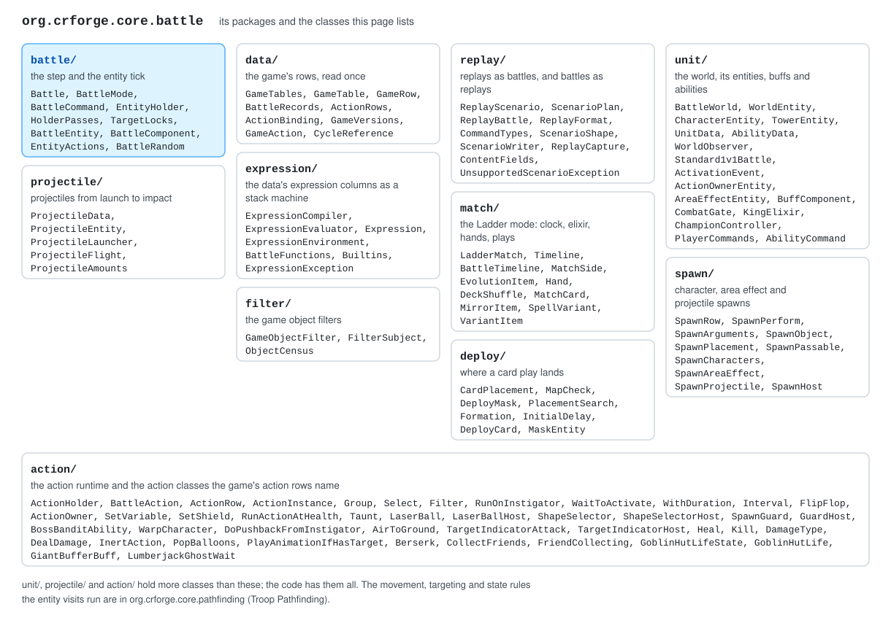

# The battle core

The battle core (`org.crforge.core.battle`) is crforge's engine. It only takes in behaviour that is established, and every class in it says which parts are settled and which are not. Run `./gradlew :core:fidelityReport` to see how far that has come.

It reads the game's own tables of one data version and is held tick by tick to battles recorded in the game (see [Game Tables and Reference Battles](game-tables.md)). The debug visualizer runs on it (see [Debug Visualizer](architecture.md#debug-visualizer)), and so does the reinforcement learning environment (see [The Environment](environment.md)).

The battle rules follow game client 16.635.1 (`GameVersions.CLIENT_16_635_1`) since 2026-10-28, and the battle refuses tables of a data version that client does not run (`BattleWorld.requireModelled`; see [Compatibility](compatibility.md)). Before that they followed client 16.402.17, and a comparison with 16.402.17 on this page dates from that move.

The reference battles, listings and coverage sets this page cites (`golden-gaps-v1`, `tv-replays-v3`, the `*-v1` listings, the `card_*` cases and the others) were first recorded on the 16.402.x data versions, played on client 16.402.17. Each reference listing has since been recorded again under its own name on 16.635.3, the game's own recordings of the same scenarios on the 16.635.3 tables, and CI holds those to `conformance/reference-expectations/16.635.3.json`; the coverage set CI scores is one of 16.635.3's own battles. A rule this page marks as client 16.635.1's own and held by no reference yet rests on the unit tests until a recording reaches it.

crforge began with an engine written from observation and a reference port, which the fidelity ledger listed almost entirely as a guess. The battle core was grown beside it a milestone at a time and replaced it; that engine and its card data are gone.

## Three footings

Three properties of the established behaviour cut across the whole engine, and the battle core is built on them:

- **Time is integer milliseconds.** Every duration is whole milliseconds stepped by exactly 50, so a duration of `ms` lasts `ceil(ms / 50)` steps.
- **A tick is passes over the whole entity list, not a chain of systems.** Every entity's targeting runs before any entity's movement, which runs before any entity's state visit, over a snapshot of the entity list taken at the head of the tick and ordered by id.
- **Commands run before the entity tick.** A card play runs twenty ticks after a player makes it, at the head of its step, and the entity tick of that same step admits and visits what it creates.

## Package layout

The tables below say what each of those classes is, package by package. `unit/`, `projectile/` and `action/` hold more classes than they list; the other packages are listed in full.

**`org.crforge.core.battle`**: the step and the entity tick.

| Class | What it is |
| --- | --- |
| `Battle` | the step: clock, entity tick, commands, tick counter |
| `BattleMode` | when the match is over; what the mode does before the entity tick |
| `BattleCommand` | a tick-stamped action from outside the entity tick |
| `EntityHolder` | the entity tick: every hook and pass of every entity, in one fixed order |
| `HolderPasses` | the once-per-tick work around the entity visits |
| `TargetLocks` | which object holds which target, per channel, granted after phase 3 |
| `BattleEntity` | a container of four component slots with a pre-hook and a post-hook |
| `BattleComponent` | one slot: a refresh and a visit |
| `EntityActions` | the five action passes of one entity |
| `BattleRandom` | the battle's random source: one shared 32-bit xorshift state |

**`expression/`**: the data's expression columns as a stack machine.

| Class | What it is |
| --- | --- |
| `ExpressionCompiler` | the data's expression columns into opcode words, with the fold |
| `ExpressionEvaluator` | the stack machine that runs them over 32-bit integers |
| `Expression` | one compiled expression: its words and its stack depth |
| `ExpressionEnvironment` | what an expression's symbols name and what each call answers |
| `BattleFunctions` | the 47 names of the battle's functions, their ids and argument counts |
| `Builtins` | the functions every expression may call whatever its environment: min, max, abs, clamp, select and the two logarithms |
| `ExpressionException` | a string the expression compiler refuses |

**`unit/`**: the world, its entities, buffs and abilities; its main classes.

| Class | What it is |
| --- | --- |
| `BattleWorld` | the routing grid, the building overlay and the spatial index, rebuilt per tick; owns the holder, hands launched projectiles to it, and is where damage lands |
| `WorldEntity` | an entity that stands on the arena, with its targeting component's state |
| `CharacterEntity` | targeting in slot 0, movement in slot 1, the state visit as the post-hook |
| `TowerEntity` | a crown tower: targeting in slot 0, the state visit and the combat gate as the post-hook |
| `UnitData` | the published columns of a unit, unconverted, its projectile row among them |
| `AbilityData` | a unit's ability row: its cast, its trigger, the target it keeps, its action |
| `WorldObserver` | what watches the arena from outside the tick: hits, areas, launches, impacts, removals, a king tower's activation |
| `Standard1v1Battle` | the standard arena with its six towers |
| `ActivationEvent` | one step of a king tower's activation, as observers are told it |
| `ActionOwnerEntity` | an object that only owns actions, standing in for the objects that run spawn rows in the data |
| `AreaEffectEntity` | an area effect: an object of its own kind that stands at a point for its life and hits the area around it on a schedule |
| `BuffComponent` | the buffs listed on a character or a tower, in slot 3, and what they make of its speeds |
| `CombatGate` | the combat gate at the tail of the state visit: whether the targeting component is on for the next tick, and when the reference is dropped |
| `KingElixir` | the kings' elixir, which the units pay into and the abilities draw on |
| `ChampionController` | one champion slot of a king: the champion's cooldown, charges and button state |
| `PlayerCommands` | the commands of a Ladder battle's players, given as a player's client gives them: a card play or a champion's ability, between two steps |
| `AbilityCommand` | a player's ability command: the tap on a champion's button, run in the command pass of its tick |

**`match/`**: the Ladder mode: clock, elixir, hands, plays.

| Class | What it is |
| --- | --- |
| `LadderMatch` | a Ladder match as the battle's mode: the setup, the update's advance, the kings' visits, a play's gates and spend, the crowns |
| `Timeline` | the battle's clock: sections, the elixir rate and the next-card cooldown |
| `BattleTimeline` | a battle timeline row, as the game mode names it |
| `MatchSide` | one player: the elixir in ten-thousandths, the deck and the hand, each deck card's slot flags and the count per deck index |
| `EvolutionItem` | the item a play of a deck card carries: its evolution field, the row cast and its cost |
| `Hand` | four slots, the queue and the refill cooldown |
| `DeckShuffle` | the order a deck is dealt in, from one draw of the battle's source |
| `MatchCard` | what the match reads of a card: its cost and its opening-hand columns |
| `MirrorItem` | the card item a Mirror play carries: the card it repeats, the level it is played at and its cost |
| `SpellVariant` | a card played as one of its options (the Merge Maiden's mounted or on-foot maiden), picked from the king's elixir as the play is given |
| `VariantItem` | the card item a variant card's play carries: the option picked, its cost and the card's deck index |

**`action/`**: the action runtime and the action classes the game's action rows name; its main classes.

| Class | What it is |
| --- | --- |
| `ActionHolder` | one entity's scheduled actions behind the five passes: the pending entries, the running instances and the tags they set |
| `BattleAction` | an action: its row's shared columns, what starting it does, and whether it lasts |
| `ActionRow` | the columns every action row shares; RowAction answers them from it |
| `ActionInstance` | one run of an action that lasts, stepped by the run pass |
| `Group` | schedules every part when it is scheduled, each at its own offset |
| `Select` | schedules one part when it is scheduled, by its conditions |
| `Filter` | schedules its true or false branch when it starts |
| `RunOnInstigator` | schedules its action on the entity that caused it |
| `WaitToActivate` | lasts until its condition holds, then schedules its activation |
| `WithDuration` | lasts a fixed time, or one that follows the hit speed |
| `Interval` | lasts, and fires its action every interval unless paused by a tag |
| `FlipFlop` | lasts, and turns on and off once its condition disagrees long enough |
| `ActionOwner` | the entity a holder belongs to, as the leaves that act on it see it |
| `SetVariable` | writes a variable of its owner, which expressions naming it read |
| `SetShield` | gives its owner a shield of a share of its maximum hit points |
| `RunActionAtHealth` | lasts, and runs an action as its owner's hit points fall past each threshold |
| `Taunt` | forces its owner's target onto the parent of the area effect that caused it, with a buff, for a step; the owner's run is armed at once |
| `LaserBall` | lasts on an area effect, and at a fixed rate runs on everything its query finds around it the action their count picks |
| `LaserBallHost` | what a laser ball asks of the battle around its area effect |
| `ShapeSelector` | lasts on an area effect or a character, and on ticks set from its start, or from then on when it waits, runs an action on the object in its circle with the most hit points and shield, and one on its owner by the pick's side |
| `ShapeSelectorHost` | what a shape selector asks of the battle around its owner |
| `SpawnGuard` | makes a guard behind its area effect and sends it charging ahead after a short deploy, pushing and hitting what it passes |
| `GuardHost` | what a guard's run asks of the battle about its guard and around it |
| `BossBanditAbility` | locks its unit on itself and, a set number of battle ticks after it starts, runs its warp on it |
| `WarpCharacter` | moves its unit at once back toward its own side, off water and blocked cells |
| `DoPushbackFromInstigator` | pushes its unit a delay later along the width, away from the side of the arena its cause stands on (a cause that has left by then, where it stood as the push was scheduled), and runs its success or failure actions |
| `AirToGround` | lasts on its owner and holds it on the ground, pulling an air unit down and letting it climb back |
| `TargetIndicatorAttack` | lasts on a character, marks the nearest enemy in its ring with a signal and shoots a projectile at the signal's point a delay later |
| `TargetIndicatorHost` | what a target indicator attack asks of the battle around its character |
| `Heal` | heals its owner by its value, with its over-heal percentage |
| `Kill` | schedules its kill action on its owner, then kills it with the cause as killer |
| `DamageType` | the switches a typed hit's pipeline runs, and the actions it runs after a hit |
| `DealDamage` | queues a typed hit on its owner, with the cause as its source |
| `InertAction` | a row that changes nothing the simulation reads: an inert class, an effect or a forced animation; an effect that loops keeps a run |
| `PopBalloons` | the Skeleton Barrel's pop: a run stepped doing nothing, never finishing; a singleton's second start drops a container as an area effect |
| `PlayAnimationIfHasTarget` | the Goblin Cage's shake: a run stepped doing nothing, never finishing |
| `Berserk` | the Berserker's starting action: a run that sets the attack sequence index to 0 and flips it on every attack that lands |
| `CollectFriends` | lasts, and claims the nearest friends through the target locks, requests the ability and fires a projectile at each |
| `FriendCollecting` | what a collector asks of the battle around its unit |
| `GoblinHutLifeState` | lasts, waits for an enemy within the hut's reach and spawns toward it at an interval while it holds one |
| `GoblinHutLife` | what a Goblin Hut's life state asks of the battle around its building |
| `GiantBufferBuff` | lasts, and adds damage to every so many of its unit's hits, a projectile's through the copy it carries |
| `LumberjackGhostWait` | lasts on the evolved Rage Barbarian's ghost, swaps a buff applied to it for the one it considers, and once armed kills the ghost when that is gone |

**`data/`**: the game's rows, read once.

| Class | What it is |
| --- | --- |
| `GameTables` | a folder of the game's own tables, one data version, and its action graph |
| `GameTable` | one table's rows by name, in creation order |
| `GameRow` | one row: its index, its class and its columns under the game's own names |
| `BattleRecords` | the battle's units, projectiles and troop cards built from those rows |
| `ActionRows` | the battle's actions built from the game's action rows, for one entity |
| `ActionBinding` | what an action row needs from its entity: expressions, variables, tags |
| `GameVersions` | the game versions the simulator knows, named once: the data versions, the client versions and the data versions each client has run |
| `GameAction` | one action row of the data: its name, its class, its ClassType and its fields as the data writes them |
| `CycleReference` | a row named again while it is still being built: a reference back into a cycle of rows, which answers as that row once it is built |

**`spawn/`**: character, area effect and projectile spawns.

| Class | What it is |
| --- | --- |
| `SpawnRow` | the columns of a character spawn row, at its source or to a location |
| `SpawnPerform` | the row's perform: its source, its point, the block the spawner is handed, and the calls made on the children after the spawn |
| `SpawnArguments` | the block the spawner is handed |
| `SpawnObject` | a game object as a spawn reads it |
| `SpawnPlacement` | where the spawner places each child: on the point, or on a ring |
| `SpawnPassable` | the in-front test: off the arena or over water refuses a point |
| `SpawnCharacters` | the action: the perform's block handed to the battle's spawner |
| `SpawnAreaEffect` | an area-effect spawn: the area effect at the owner's point, for the cause's side and at its level, the cause its parent; a row that follows its parent follows the owner |
| `SpawnProjectile` | a projectile spawn: the projectile from the owner's point at the row's height, aimed by the row's two expressions, at no target |
| `SpawnHost` | an object a spawn can come from, which reaches the spawner |

**`filter/`**: the game object filters.

| Class | What it is |
| --- | --- |
| `GameObjectFilter` | one filter row: whether an object passes it, for a team and a name |
| `FilterSubject` | an object as a filter asks about it |
| `ObjectCensus` | what a check that counts the battle's objects asks of the object it runs on |

**`deploy/`**: where a card play lands.

| Class | What it is |
| --- | --- |
| `CardPlacement` | one card play worked out: the map check, the search, the column, then each unit's offset, position, lane and start |
| `MapCheck` | the raw requested point: on the map, and on a cell that may take the card |
| `DeployMask` | the tiles a card may be placed on: the towers' boxes and the buildings |
| `PlacementSearch` | the clamp, the snap and the nearest legal tile in square rings |
| `Formation` | where the index-th unit of a card stands around the placed point |
| `InitialDelay` | whether a unit starts deploying or waits its turn |
| `DeployCard` | the columns of a troop card its placement reads |
| `MaskEntity` | a character as the deploy mask sees it |

**`projectile/`**: projectiles from launch to impact; its main classes.

| Class | What it is |
| --- | --- |
| `ProjectileData` | the published columns of a projectile row, unconverted |
| `ProjectileEntity` | a projectile in flight: an entity of its own kind in the same holder |
| `ProjectileLauncher` | the hit application's projectile path: count, spread, start, aim, hand-over |
| `ProjectileFlight` | one step of the flight, the arrival and the impact |
| `ProjectileAmounts` | the damage and the crown-tower damage at the projectile's level |

**`replay/`**: replays as battles, and battles as replays.

| Class | What it is |
| --- | --- |
| `ReplayScenario` | translates a replay into the battle's inputs: each of its fields consumed, pinned or carried |
| `ScenarioPlan` | a replay translated into the battle's own inputs: the seed, towers, decks, levels and commands |
| `ReplayBattle` | the battle a translated replay gives, and the check of each play's item as it runs; a conformance run and the replay viewer build it the same way |
| `ReplayFormat` | the replay fields that differ between data versions, and how each is read |
| `CommandTypes` | which command type is a card play and which an ability command, in one data version's replays |
| `ScenarioShape` | the kind of scenario a run reads, a replay or a generated case, which decides the fields it is read by |
| `ScenarioWriter` | writes a battle as a replay of the tables' data version, which reads back to the same battle, step for step |
| `ReplayCapture` | a replay's capture block: the client version and the data the session that recorded it ran |
| `ContentFields` | the fields that name a data version and its content sha in the files the replay and reference tools read and write |
| `UnsupportedScenarioException` | a scenario input the battle core has no mapping for: the run is reported unsupported, naming it |

### Rows, actions and the strict builder

The battle core reads its units and projectiles as the game's own rows. `org.crforge.core.battle.data.BattleRecords` builds them from the game tables. The tests that play the reference runs take their units from it, so they need the tables configured and fail without them.

A unit that fires and has no damage of its own deals its projectile's damage at its level, as the game's damage getter falls back. The crown towers are built from their rows too: the king tower's and the princess tower's shots scale by the tower rules their rows name, 109 at level 11.

The battle's actions come from the game's action rows. `ActionRows` builds a row with the class its class type names, from its columns, and every row it names in turn, for one entity, compiling its expressions for that entity. The battle declares the tables' variables and game tags, a tag as the bit its row's index gives.

The builder is strict. A column it neither reads nor knows to be presentation only is refused, and so is a class the battle does not have. The unit, projectile, area effect and buff rows are held to the same rule:

- A row is read through a view that records the columns read.
- Every column it sets that is not read, not presentation, not shown inert by the record and not pending a trace is listed as not modelled. That refuses the row where an entity is made of it, a tower included.
- The presentation columns - art, texts, effects, shadows, animation, health bars - are classified by what they name.
- A column whose role is not yet established would be carried unread as pending until a trace settles it, and none is now.

Of the 946 rows of the data, 425 are built today. The rows that only show something - the four classes the runtime never reaches beyond scheduling, the effects, the forced animations and the animation modifiers - are built as inert actions. An effect whose flags loop it or tie its life to its run's keeps a run that never finishes by itself, and a row without a run never sets its tags.

A battle is made on the tables. `Standard1v1Battle` takes them, and its world declares their variables and game tags and keeps the records and action rows its entities build from. A unit carries the names of its row's three hook actions - on starting, on death, on being killed - which nothing fires yet.

### Cards from their rows

A card play's card comes from its row too: the units it summons, how many, its formation and where it may be placed. A card's level index, which the game never reads, is not read here either. Nor is a card's deploy time of its own, which nothing on the placement's path reads.

A troop card may summon a list of characters in place of its groups, as the Three Musketeers' does, or after its first group, as the evolved Skeleton Army's general follows its fifteen soldiers.

- The card's first unit, which the map check and the search read, is its summoned character, else the list's first character.
- Each listed character is created after the groups' units at an offset of its own, both negated for the bottom side. For the top side, the one across the width is negated on the right half of the arena when the card mirrors it.
- A group card links the listed characters into its chain after its soldiers.
- A card that lists characters besides a second group but no first is refused, as none does.

### Spells

A spell card summons nothing and casts. It is played by the same command, its point clamped and snapped to the tile centre - or, for the Goblin Barrel, searched for its projectile's Goblin, with the symmetric adjustment. In the command pass of its tick, one of two things happens:

- Its area effect is created at the placed point.
- Or its projectile starts from its side's king tower, at the centre and three times the king's collision radius up, with no target, and flies to the point.

Both are admitted by that step's opening cleanup and first act in its post-hooks, at the card's level re-based on their own rarity.

#### Arrows

Arrows casts three waves of ten projectiles, 200 ms apart, each wave a chain.

- The first arrow's ring point is the placed point. The others' stand on a ring of the spell's radius less six tenths of the arrow's, 40 degrees apart.
- Each aims at its ring point plus six tenths of the arrow's radius turned by a battle random below 359, kept within nine tenths of the spell's radius of the placed point.
- Each starts from the king tower shifted by a quarter of that offset across and the whole of it along.
- A delayed arrow counts its delay down 50 a visit without moving, so the later waves first move four and eight ticks after the cast.
- A chain's arrow deals its damage on its ring point, to the victims that stand in the chain's circle too - the placed point and the spell's radius - and not to one the chain has hit already.

#### The Log and the Barbarian Barrel

The Log and the Barbarian Barrel are thrown. The point snaps to the tile centre. The projectile starts its MinDistance behind the point toward the caster's own side, at five times the king's collision radius, and falls to the point at the height of the rolling projectile it spawns. Its impact launches that one from where it landed, aimed its range beyond, along the line it came.

A projectile that flies to a point this way runs a pass over what its body covers - the spatial index's box of its body radius and half height, one hit id a pass - as it is registered and after every step. Each entity found takes the travelling hit, except:

- None of its own side.
- None it has hit already.
- No character that takes no part in contact in any state - under the no-check-collisions tag, as the Little Prince's guard is from its deploy to the end of its charge, attached to a parent, or a building of the characters table beside another building. Such a character is passed by without being listed, so the body can hit it once that is over.

The travelling hit is the damage at its level or the crown-tower share, and a push away from it, its row's push-all lifting the gates, on a character whose movement is still on. The rolling barrel's arrival spawns its Barbarian at its aim.

#### Projectile impacts

A projectile's area impact pushes its victims its row's pushback away from the impact point. A projectile that spawns characters makes them in the card formation around the impact point, at its level, deploying for its row's deploy time. Each is registered with its registration visit and then moved off the water onto its created point.

### Entities and the rules they run

Every entity is of a kind - area effect, projectile, character - and its id is its kind's band of a
million plus a per-kind counter taken the moment it is handed to the holder, so a projectile
launched in the middle of a battle is still ahead of every character in the holder's id-sorted
list. Every troop and every building is a character.

The movement, targeting and state rules themselves live in `org.crforge.core.pathfinding` (see [Troop Pathfinding](pathfinding.md)). The battle core runs them directly, inside its entity tick.

Level scaling, the hit-points object and the damage chain live beside those rules in `org.crforge.core.pathfinding.combat`:

| Class | What it is |
| --- | --- |
| `RarityTable` | the published rows |
| `PackedLevel` | a level as an entity carries it |
| `ScalingGlobals` and `LevelScaling` | a stat at a level, under the card rule and the tower rule |
| `HitPoints` | what damage lowers, with the alive and removal tests |
| `DamageApplication` | one damage event reaching an object: the guards, the amount the two sides' buffs make of it, the dedupe list, the shield and the subtraction |
| `AreaDamage` | damage landing on a circle: which entities it collects, in id order through the shared validator, and what each takes |

Every arena entity is created at a level and scales its hit points and damage once, at creation.

The attacker's half of a hit stays with the targeting rules:

- `HitApplication` is the hit the targeting visit fires: the component writes, the long-distance cancel and the damage of one hit at the owner's level.
- `DirectHit` is how a hit without a projectile reaches its target, with the plain damage and the crown-tower damage and the direction it came from.

A unit with a projectile row launches instead, through the battle's `ProjectileLauncher`. The projectile is created in the attack tick and has its id at once. It enters the holder's live list at that tick's closing cleanup and flies from the next tick on.

### The dependency rule

`org.crforge.core.battle` and `org.crforge.core.pathfinding` may import each other, `org.crforge.core.fidelity` and `org.crforge.core.util`, and nothing else from this code base. The core module's main code holds no other package. `BattlePackageDependencyTest` enforces both.

Without the rule a single import would let guessed behaviour into a class that claims to be settled, and a second engine growing beside the battle core would again hold inferred behaviour next to the settled rules.

## One step

The diagram shows the battle core's inside: the game tables read once, the commands that drive a battle, one step and its entity tick, and what is read out of it. The numbered lists below give the full order.

`Battle.step()` is 50 ms of game time:

1. If the mode says the match is over, nothing happens at all: no clock, no entity tick, no tick counter.
2. The clock advances by 50 ms.
3. Due commands run, in the order they were queued: every command whose tick has come, a late one included.
4. The mode update runs. It either lets the entity tick run, handing it the current tick, or declines, in which case the holder is only cleaned up.
5. The tick counter advances.

So what a command creates is handed to the holder before the entity tick of its own step, and the tick's opening cleanup admits it. A unit placed on tick `n` is first visited on tick `n`, as the reference runs have it, with no offset anywhere. The towers of a standard battle are placed straight into the live list when the battle is set up, so they stand from the first tick.

`EntityHolder.tick()` is the entity tick:

1. Cleanup: drop removable entities, telling every remaining entity of each removal, then fold the entities handed over since the last cleanup into the live list, which stays sorted by id.
2. Take a snapshot of the live list. Every entity loop below runs over it.
3. The holder pre-pass: the spatial index and the building overlay are rebuilt from the snapshot.
4. Every entity's pre-hook.
5. Every entity's pending actions of phase 1.
6. One whole-list pass per component slot, lowest first: the component's refresh, then its visit when the component is switched on. Targeting is slot 0, movement is slot 1.
7. Every entity's running actions.
8. Every entity's pending actions of phase 2.
9. Every entity's post-hook: for a projectile its flight step, for a character its state visit, in that order because of the id bands.
10. The holder's after-post-hooks step, then every entity's pending actions of phase 3.
11. The holder post-pass: the overlay is rotated and the index cleared.
12. Cleanup again.
13. The end-of-tick action countdown, over the live list rather than the snapshot.

Three consequences that everything else leans on:

- Entities are visited in ascending id, which is creation order within a kind with every projectile ahead of every character.
- An entity added during a tick is not visited until the next one.
- An entity that becomes removable during a tick is visited for the rest of it and is gone before the next snapshot.

### When a player's command runs

A player's command does not run when the player gives it. The game client stamps it with its given tick: the battle's tick counter at the moment it is given between two steps (the number of the next step), or 1 while the counter is still 0. The command runs in the command pass of step given + 20, one second of game time later, on both players' clients. Everything a command does - the placement, the elixir it spends, the card it cycles, the ability it starts - happens at that run, against the battle as it stands then.

- **The 20 is fixed, not a floor over network delay.** Nothing in it depends on the connection. A client that hears of a command after its run tick has passed goes back to a saved state of the battle and plays forward again, so the command still runs on given + 20 in every client's battle. Only a command more than about 200 steps late would run late, at once.
- **Which commands.** Every player command of a Ladder battle: a card play (a Mirror and a variant card included) and an ability command naming a champion or hero. The game has two more command kinds with the same delay, a choice by index and a spell pick, used by other modes; no Ladder battle carries them.
- **What the player's client checks at the giving.** Before sending a command the client tries it against the battle as it stands and drops it if it would be refused.
  - For a card play: the match must not be decided, the king alive, the card in the hand, the elixir must cover its cost after setting aside the costs the side's waiting commands have promised, and the map must take the point. The try makes no placement search of its own: the screen has already made one, below.
  - For an ability command: the run's gates, its elixir gate setting the promised costs aside.

  A command that passes promises its cost until its run, or, refused at its run, until 60 steps after its giving. An ability command's run releases its promise before its gates.
- **Where a tapped card goes.** The player's screen does not send the point the card was dropped at. On the drop the client runs the placement search, the same one the run makes, against the battle as it stands at that moment. The command carries the tile the search found: the nearest tile the card may take (for a troop, a tile of its own half or of an open pocket, never on a tower's or building's footprint), at the tile's centre, or a building's tile corner.

  A troop dropped in the enemy half, on the river, on a tile the map check refuses or inside a building is moved before anything is sent, not refused. A drop is cancelled, with nothing sent, only when the search finds no tile, when the card is dragged back over the hand, or when the client's try refuses it. Since the command already carries a legal tile, the try's map check does not refuse a play the screen made.

  At the run the placement search runs again from the tile sent. That moves it only if the board changed in the 20 steps between: a pocket opened or closed or a building placed or destroyed. The recordings agree: every play of the live Ladder battles in the coverage sets of 16.402.19 and 16.402.21, about 820,000, is sent on a tile centre or a building's tile corner.
- **The earliest play.** A card play is refused while the battle's tick counter is below the game mode's start cooldown. That is the game mode row's `BattleStartCooldown` in milliseconds over 50, or, where the row leaves it empty, the global `LOGIC_BATTLE_START_COOLDOWN` over 50. Ladder and Ranked1v1_NewArena leave the column empty and the global is 4500 ms in 16.402.18, 16.402.19, 16.402.21 and 16.635.3. So a play can be given from tick counter 90 (4.5 seconds) and runs at 110 at the earliest.

  The play checks it among its own gates, after the card's hand slot and before the elixir, with code 22. It does so in the client's try at the giving, so a card dropped earlier is refused and nothing is sent, and again at the run. An ability command has no such gate. Whether the screen also holds the hand back during this time is not established.

  No live Ladder battle of the coverage sets, 11,733 battles, gives its first play before tick 103. Some reference battles give a play at tick 80, which a player's client would refuse, but those run at tick 100, after the cooldown, and are placed.
- **What the run checks.** The battle checks the play again at its run and only then spends the elixir and moves the card to the back of the queue. A play refused at its run changes nothing. It is not retried.
- **Several waiting commands.** A player may give another command while one is waiting. The client sets no limit beyond the elixir check. Captured Ladder battles have up to three commands of one side waiting at once, and two given on the same tick.
- **When the next card joins the hand.** A play takes its card out of the hand at its run, not at its giving: until then the card stays in its slot, offered by no screen (above). At the run the card goes to the back of the queue, and the empty slot takes the queue's front once the hand's refill cooldown has run out (`Hand`). The cooldown counts down 50 ms a step and restarts only when a slot is refilled, at the timeline's next-card cooldown (`NextSpellCooldownMS`, by the battle's time). So a play run a cooldown or more after the last refill gets its next card on the step of its run, and one run sooner leaves its slot empty for the rest of the cooldown. Both hands are observed on every tick of every reference and coverage battle, which all match. In the first 1,000 battles of the 16.635.3 coverage set, each of 64,132 plays names a card in its side's hand on the tick before its giving, never a card of the queue. What an agent is shown of it, and what the screen does as a new card arrives (it holds none back), are in [The hand after a play](environment.md#the-hand-after-a-play).
- **The end of the battle.** A command that arrives once the battle is over is dropped. No recorded command runs after its battle's last tick.

The recordings agree: every command of every reference battle and coverage battle of 16.402.18, 16.402.19 and 16.402.21, about 880,000 commands, most of them plays of live Ladder battles in the coverage sets, runs exactly 20 steps after its given tick. A replay stores both ticks: `t`, the given tick, and `t2`, the run tick.

#### Giving a command in the battle core

In the battle core `Standard1v1Battle.PLAY_DELAY_TICKS` is the 20. A player or an agent of the battle core gives its commands through `PlayerCommands`, as a player's client does:

- `playCard` plays a deck card, a Mirror or a variant card, from a hand slot.
- `useAbility` names a unit a play of its side made.

Both stamp the command with the tick counter, or 1 at tick 0, and queue it to run 20 steps after the stamp. They first try it as the client does, returning a `Giving` that names the refusal (`Refusal`, with the command's own code) or the given and run ticks, the cost promised and, for a play, the point sent. A refused giving changes nothing.

#### Sending a play

A play is sent as the screen sends it. `playCard` runs the play's own placement search (`Standard1v1Battle.searchPlacement`, the search the run makes, with no map check before it) on the dropped point against the battle as it stands, and the command carries the tile found. So a troop dropped in the enemy half, on the river, on a tower, off the map or on a cell the map check refuses is moved, and a spell is sent on its tile's centre.

It refuses a play only when the search finds no tile (`NO_TILE`, the screen's, with no code). On the standard arena that is a Mirror while its king has no last card, as the search places a Mirror as the king's last card.

The try of a play is:

- The match's gates: decided, king dead, card in a hand slot, the start cooldown.
- The whole elixir less the costs the side's waiting commands promised covering the item's cost.
- The map check on the tile sent, which a tile the search found always passes.

The screen's search comes before the try in the client, and a drop both refuse is reported here as the try refuses it. At the run the play's placement searches again from the tile sent, against the battle as it stands then. The try of an ability command is the run's gates with the promised costs set aside.

#### Items and promised costs

The client builds the item as it gives the play:

- A deck card's from the side's count.
- A Mirror's from the last play of its side it still lists as promised, or else the last card.
- A variant card's option picked from the elixir less the promised costs, which the play carries.

Each command given promises its cost until its run places it, or, a play refused at its run, until 60 ticks after the counter it was given at. An ability command's run releases it.

Besides the client's try, the screen does not offer a card while a play of it from the same hand slot waits (`CARD_PENDING`). No recorded Ladder battle plays a card while a play of the same card of its side waits, though tens of thousands of plays are given while another play of their side waits.

#### Trying without giving

- `tryCard` makes the same checks without a point and without giving anything, for a hand slot's availability (the desktop hand, an agent's mask). It does not run the search, which finds a tile from every point of the standard arena, but refuses a Mirror whose king has no last card as `NO_TILE`.
- `tryAbility` tries an ability command naming a unit the same way, with the same gates and refusals as `useAbility` and nothing given (an agent's mask of a champion's button).
- `promised` reads the costs a side holds back.

Where a card would land is read the same way, changing nothing:

- `searchCards` names the card or cards the screen's search is handed for a hand slot's play now (none when the try refuses it).
- `Standard1v1Battle.placementEntities` names the characters the search's deploy mask reads, kept by a filter (an agent keeps those its seat sees).
- `PlacementSearch.landingTiles` names the tiles of the mask's grid from whose centre the search does not move the card, its first ring's snapped point legal (an agent's mask of the tiles a card lands on unmoved).
- `DeployMask.reads` names the characters the mask reads at all, alive buildings and king towers.

The desktop session gives the screen's plays through `PlayerCommands`.

#### Queueing a command directly

`Standard1v1Battle.submit` stamps a deck card's play the same way without the client's checks. `play`, `playMirror`, `playVariant` and `useAbility` take the run tick and take the given tick as the run tick less 20. Each also has a form that takes the given tick and the run tick both, and refuses a command whose run is not 20 steps after its giving.

`ReplayBattle` queues each recorded command with the two ticks the replay states. The battle reads that given tick wherever the client's view at the giving matters: a Mirror's item, an evolution card's count and the promised costs.

`ReplayScenario` refuses a replay with a command given before tick 1, which no client stamps, or run at any delay other than 20 steps, which no battle of the game holds. The battle builds a play's item as the player's client built it at the giving, and a client giving at another delay does not exist to follow. No recorded command has another delay, so no recording holds the refusal. It rests on the delay being fixed in the game, as above.

#### Deciding at t, running at t + 20

A player or agent decides at tick `t` from the battle as it is at `t` and sees its command take effect at `t + 20` against the battle as it will be then. The placement found then can differ from the one previewed at `t`, and the elixir can have moved.

#### The start cooldown in the battle core

The start cooldown is one of `LadderMatch`'s play gates, code 22 after the hand slot and before the elixir, read from the game mode row or else the global. It is checked:

- At the run, with the run's tick. A play queued to run earlier, as a replay's or a test's, is refused there as any play the gates refuse (nothing placed, the elixir and the hand unchanged).
- At the giving, with the tick counter, where `PlayerCommands` refuses the play as `Refusal.START_COOLDOWN`.

An ability command has no such gate. The reference battles of `play-start-cooldown-v1` hold the run's gate: one side's plays given at ticks 50, 69 and 70 run at 70 and 89, both refused, and at 90, placed.

A replay keeps the point it recorded: `ReplayBattle` queues it as sent, and the run's placement search places it, as it places every recorded point.

## Tests and game data

The unit tests read the game tables of the version `crforge-data.lock` names and hard-code no game data, so moving to a new data version needs no test edit unless the new version changes a behaviour the battle core must port. Every amount a test asserts stays exact, with no tolerance. A test takes one of three forms:

- A mechanic test writes the rows it counts on: rows of its own, or the lock's tables copied with the columns it needs written (`GameData.altered`, `alterLoaded`, `columns`, `fields`, `writeTowers`), and pins the exact outcome of those rows.
- A test of a shipped row reads the raw column (`Shipped.row`, `unitRow`, `number`, `scaled`, `cost`, `rarity`, `battleTicks`) and works the expected value out with its own arithmetic, never through the production code it tests.
- A census over the shipped rows asserts an invariant, never a count.

`GameData`, `Shipped` and `Scenarios` (battles and replays a test writes) are in `core/src/testFixtures`, shared by the core, conformance and desktop tests. Recordings of the game belong in the game data repository and are never committed here, and no test of the battle core reads a recording or a model's output. Test names and comments follow the same rule: they name the column a value comes from, not the value one version ships.

## What is covered today

### Walking and locking on

A ground character deployed on the standard arena walks its lane, picks its target, routes around buildings, is pushed and steered by other characters and by the towers, and locks onto a tower, tick for tick as the recorded reference battles hold it.

For its first ten walking ticks it only considers the towers of its own lane. So a unit deployed near the middle walks at its lane's princess tower before it turns to the king.

Its state changes carry what the standard game attaches to them:

- Taking a target prepares the route at once.
- Stopping empties it.
- Resuming prepares a new one before the next movement visit.

### Attacks and deaths

Once locked on, it attacks. An attack starting from zero is credited the whole of a run-down load, so the first hit lands nine ticks after the lock and the rest follow at the hit speed. Each hit lands on the target and takes its hit points down by the character's damage at its level.

A tower whose hit points reach zero is dead. A princess tower leaves the holder in the closing cleanup of the tick it dies, and every other entity is told at once.

Until then it is still a target. A targeting component's bypass byte is 1, so its validator never asks whether the target is alive. A unit visited later in the same pass keeps a target that died earlier in it, its attack time going on and a hit that falls due landing on it. It keeps it until the cleanup's removal notice drops it and, with an attack running, starts its target-lost timer.

A unit that loses its reference during its first, preloaded windup asks the lost-reference query:

- A row without a projectile or with a homing one stops. Its attack time stands while the timer runs to the attack finish time, as after a loss in any later windup.
- A row whose area is centred on itself, one whose burst is running and one whose projectile does not home run on to a hit with no target.

The king tower is never removable. It stays in the holder, and a unit that held it drops it through its own targeting on its next visit, with no removal notice and so no wait.

At the tail of every state visit the combat gate runs. An entity that is dead or still deploying has its reference dropped there and its targeting component switched off. So a unit's reference is gone on the tick it dies, and a king tower that dies fires no more.

A stunned entity has its reference dropped there too, even with its targeting component off, as a troop a hook pulls has it. A character that was attacking it drops the reference and, with an attack running, stands for the attack finish time before it takes its next target and resumes its walk.

The reference battles hold the attack, its cadence, the deaths and the removals. A princess tower falls in many of them, and in one a P.E.K.K.A destroys a princess tower and then the king.

### Projectiles

#### Launch, flight and impact

A character with a projectile row fires instead of hitting. Each of its hits creates its projectiles in the attack tick, starts them the unit's launch radius along the line to the target and its launch height up, and aims them at where the target stood at the start of the visit.

A projectile is an entity of the holder like a character, of its own kind. So it flies in the post-hook pass of every tick from the one after its launch, ahead of every character. A homing projectile re-pins its aim onto its target each step, moves its speed along the line and takes the height the arc gives there. It arrives on the step that reaches its aim.

On arrival it is released, which makes it removable. Its impact deals its row's damage at its level - or the crown-tower share of it to a crown tower - to a target that still has hit points. A projectile whose target left the battle flies on to where the target stood and lands on nothing.

#### Hopping projectiles

A hopping projectile counts each launch and lists each target. After an impact under its count it hops on to the nearest character strictly inside its hop radius of where it landed, with no alive test. That character is:

- of the other side
- not untargetable
- with hit points
- accepting an attacker and not hit by it yet
- the first of equals in the order they joined

It is launched again from where it is, and waits 150 ms before it flies on, so a hop within one step of its speed lands four ticks after the impact. At its count, or with nobody in reach, it stays released. A hop after its launcher left is refused.

#### Projectiles that spawn projectiles

A projectile whose impact spawns another launches as many as the spawned row's spawn count, at least one. Each is launched from where it landed, aimed beyond its aim along the line it came.

Each is turned by the spawned row's spawn radius as degrees times its step in the fan over the count, the steps from minus half the count up by one. The Firecracker's five explosions are at -32, -16, 0, 16 and 32 degrees.

Each is handed to the holder and, flying to a point, runs its first pass at once before the next is made.

#### Constant height and limited homing

A row with a constant height starts, aims and lands at that height in place of the launcher's. The Royal Giant's cannonball starts at 1500 and descends toward the tower it re-aims at. The Elite Archer's arrow flies level at 2000. Neither the hits nor the arrival tick move, as no hit test reads a height.

A row that homes for a limited time re-aims from its launcher at its target for that time when launched far enough from it. The Elite Archer's arrow, launched more than 5000 from its target, bends toward it on its first two steps.

#### Pingpong projectiles

A pingpong row sweeps out to its aim and back instead of flying at its speed. Its time moves on by 50 ms a step - by what the launcher's buffs make of 50 ms, which no run holds. It stands at its start plus the sine of 180 degrees times the share of the time gone of the way to its aim, its height unchanged.

Its body hits what it covers where it stood before each step. On the step that crosses half the time it does not move but forgets what it has hit, so it hits each entity once out and once back. On the step after its time is up it lands back at its start on the ground, and its impact hits nothing at its aim.

Its launch holds the launcher's targeting. The visit returns before its reference check until the projectile comes back and lets it go on, so the Axe Man's next throw comes a hit speed after the return.

The launch also starts the targeting's resume delay, the sweep's time. While it runs the unit's speed budget is 0 whatever its state. An Executioner the tiebreaker's clearing resumes into the moving state while its axe is out stands through the update and dies where it stood, as a homing shot aimed at it shows (`BattlePingpongResumeStandTest`, held by the generated tiebreaker battles of an Archer shooting at an Executioner).

The return tells only a targeting component that is on. A launcher whose targeting is off, as a stun leaves it, keeps the hold until the projectile leaves the battle at the cleanup closing that tick. That cleanup's notice reaches every component, one that is off too, and the launcher forgets it (`BattlePingpongReturnStunnedTest`).

A pingpong row that a spell casts or an impact spawns is refused.

#### Several projectiles per attack

A unit whose attack launches several projectiles launches its custom first projectile first when it has one. It places every further one a battle random distance between a quarter of its spread and the spread out, turned by its share of the circle.

Under a custom first projectile without a radius:

- The circle scatter turns that point by a battle random share of the circle.
- The line scatter throws it away and fans the projectiles about the line from the unit to its target, alternately to one side and the other, each step turned by the spread over the count in degrees. The Hunter's ten pellets are 7 degrees apart.

Without a target, as when the Hunter's target dies during its load, the first pellet still flies at where the target stood, and the line is the unit's facing. The first fan step moves the stored reference position to the unit's range ahead of it along the facing. Each further pellet is aimed along the facing turned by its step, from the unit (`BattleHunterFanNoTargetTest`).

#### Delays, first pass and collisions

A row with a random delay waits a draw below it from the same source before it flies. Every projectile that flies to a point, unless it sweeps, runs its first pass as it is registered, widened by its row's start radius and whatever its delay.

A row that stops at collisions is finished by the first hit its body lands on an entity with hit points left, which ends that pass. Reaching its aim without one, it is released where it stands without an impact. At point blank all ten of the Hunter's pellets hit the first Knight as they are launched, and none reaches the second.

A unit tunnelling to its placement (a Miner, an evolved Goblin Drill relocating) is no exception to a flying body:

- It is listed as hit and the hit is queued for it, which the damage drain refuses while it still tunnels. A hit queued on the step it surfaces lands.
- A pellet stops at it.
- The body's push is refused, a tunnelling unit being hidden, as every push request refuses a hidden unit unless its caller reaches hidden ones.

#### Projectiles with a radius

A projectile row with a radius does not hit its target alone. Its impact damages everything the area damage collects in the circle around its aim:

- an entity the validator accepts
- on a layer the row reaches
- inside the circle (a building by its square)
- at most one tower-slot entity per area

It spares the launcher's own side only when the row says so.

`BattleProjectileFlightTest` holds a shot's launch, every flight step and its impact on rows it writes. The reference battles observe every projectile's position on every tick.

### Area hits without a projectile

A character without a projectile whose row has an area radius does not hit its target alone either. Every landed hit damages a circle through the same area damage, with the character as the owner. The circle is around the character, for a row that centres its area on the unit, or around where its reference stood at the start of the visit.

The character's own targeting columns decide what the validator accepts, so its own side and the character itself are spared. Its target takes its share only as one of the victims. Nothing is pushed, as no row of the data pushes with a hit.

Such a row may also wait its own time instead of the global one before it takes a new target after losing one - the Valkyrie's is 100 ms.

Three runs hold it:

- a Valkyrie hitting the princess tower alone
- the Valkyrie with an enemy Knight at the tower, both damaged by every hit
- the Valkyrie fighting an enemy Knight beside her own princess tower, which her circle spares

The last two are the first runs with two units, one walking at the other. A unit's movement reads its reference where it stands at that moment. So a unit visited later in the movement pass steers at a unit visited earlier where that one has just moved.

### The towers fight back

The princess towers fight back. Every tower carries the same targeting component as a troop, in the same slot, and no movement component, so it stands for its whole life except to attack.

With nothing in range it holds the opposing side's tower its default selection gives as its reference, out of range, and selects again every tick. A unit that walks into its range is locked on at once. The tower fires its projectile row on the attack ticks through the same projectile path a Musketeer uses.

The building branches of the targeting visit apply. A target that steps beyond the range and both radii is dropped at once, without the extension a unit keeps a target by. A hit is never cancelled for distance.

Each arrow puts the damage it will deal on its target as pending as it starts its flight, and hands it back as it arrives. While the damage pending on its target will kill it, whether the tower's own arrow or another shooter's shot carries it, the tower's own validator refuses the target. But the tower, having hit, keeps it, and its visit marks it kept.

When the target dies, whoever kills it, the removal clears the reference. If the tower's last visit kept it, the removal skips the retarget load, so the tower selects again on the next tick. A target that dies otherwise starts the target-lost countdown, and the tower takes its default reference or another target on the sixth tick after the death.

A tower sees its target alive on the tick it dies to another unit. The towers are visited before every card unit, and a projectile lands only after every targeting visit. So when another unit kills the tower's target while its arrow flies:

- A target the arrow would not have killed starts the countdown.
- One it would have killed, a decaying Cannon say, leaves the tower selecting again on the next tick.

A tower's post-hook is the state visit, which steps its elapsed time from its first tick. The combat gate follows it and keeps the targeting component off while the tower is inactive or dead.

### The king tower's wake

A king tower sleeps until its side loses a princess tower or it loses hit points itself. Its placement queues a wait that sets the inactive tag. The first tick's first pending pass starts the wait after that tick's tags were folded in, so the king is visited on its first two ticks and then switched off.

The run pass that first sees the condition ends the wait. The wait queues a 3300 ms activating run, which the same tick's second pending pass starts. The run's tag keeps the component off until the run pass after it finishes removes it. The king's first visit therefore falls seventy ticks after the tick that saw the condition.

The tags an action sets live in the entity's one tag word, the word its flags are bits of. Each entity recomputes it at its pre-hook from the tags its handlers set for one step and the tags of the actions it runs. So the king's sleeping and waking tags are the bits the combat gate tests.

This is the first work the action passes do. It is a small action holder, shaped as the standard game's runtime is, with the actions the king's own starting row holds, built from the data: a group around the wait, the activating duration and the filter that shows the effect.

The wait's condition is the data's own expression, `king_tower_damaged() || coop_king_tower_damaged() || tower_destroyed() || coop_tower_destroyed()`, compiled once and evaluated against the battle from the king. It is the first expression the battle runs.

The reference battles hold the towers' locks, arrows and kills, since the towers fight in every one of them. `BattleTowerTargetingTest` holds the king's wake on rows it writes: a Knight destroys a princess tower, the king sees the condition in the next run pass, and its first visit locks on the Knight.

### Card plays

A troop card is played through a command. A player's play is stamped with the battle's tick counter and runs twenty ticks later, at the head of that step. Its placement is worked out against every character, live or still queued.

Its units are created at their formation places in creation order and handed to the holder, whose opening cleanup admits them, so they are visited in that same step. The first unit deploys at once. Every further one waits its turn in the waiting state, visited by neither component, for the card's stagger times its index, and then deploys for its own deploy time.

The placement reads the card's first unit's radius, angle shift and deploy time for every index, and hands the formation the second count as the row sets it. No card's units differ in them.

### Contact

A deploying unit is visited by the movement pass with no speed, so only a push moves it. Every entity takes part in contact, the towers included. A tower is a static neighbour of the push pass and an obstacle of the avoidance handler. With a mass of 0 its share of a push is a single unit, so a unit deployed against its king is pushed off it one unit a tick.

The reference battles hold card plays as the game makes them, refused plays and plays of either side among them, with every unit's position, state and hit points observed on every tick. With several units at once, the standard game shows this:

- A skeleton pushed off the bridge walks on the water beside it.
- A crowd presses some of its own inside the tower's collision circle.
- A unit whose route the follower empties holds no route until its next visit.

A static entity, a tower, makes the push pass ask whether a second one stands in line with the unit. A yes copies a push along one axis onto the other, and with the towers alone the answer is always no.

### Deaths, typed hits and spawns

An entity killed during a tick is still visited by the rest of it. Nothing on the attack path asks about the attacker, so two units whose hits fall due on the same tick can kill each other. The first one visited kills the other, whose hit, due on the same tick, still lands. A character's death switches only its movement component off, so it takes no movement visit for the rest of the tick.

A typed hit, which an action deals, is not dealt where it is dealt. The battle queues it and deals every queued hit once per tick, after every post-hook and before the last pending pass, in the order they were queued. Each goes through its damage type's pipeline, with a damage id of its own.

The pipeline's first stage scales the hit's amount, a first-level value, by its source's own rarity row and level, as a card's damage is scaled. A source that has left the battle still answers the level it had, now on the Common row.

An action can spawn characters. The battle's spawner creates each child for its source's side, kept 250 inside the arena, walking at once or deploying when its row asks. It registers the child inside the pass that ran the action.

The child takes its id and one visit of each active component at once, over the tick's index, so a unit already standing there pushes it. It joins the live list at the tick's closing cleanup and is first visited on the next tick. A spawned child cannot be targeted until its sixth state visit, so a tower locks on it six ticks late.

The pending passes run over every entity together, and an action with no delay scheduled onto any entity inside one of them starts at once.

A row's UpdatePhase of PostGameObjectTick has its queued runs taken only by the last pending pass, after the post-hooks. Such a run waits in the queue through the earlier passes, and since a pass takes an entry by swapping the last one into its place, it changes the order the entries around it start in. The Giant hero's slap push, queued on an evolved Mega Knight behind the actions its hit queued, so lets the hit's counter update start before its uppercut, and the hit after an uppercut uppercuts again.

### Pushback

A unit whose row pushes it back asks for that pushback after each projectile it launches, away from the projectile's aim. The pushback visit flies it over the next movement visits. The Sparky, recoiling from an enemy Knight, is pushed onto the river and moved off it to the nearest land before that visit's step.

Nothing moves a unit off the river otherwise. A formation played into the pocket of a fallen princess tower creates two Barbarians on the water, and they walk off it.

### Tests and reference battles

The tests and reference battles that hold each of these are listed in [The battle core's tests and reference battles](battle-core-tests.md).

## Roadmap

Every change is a pull request into `main`. Open work - mismatches, refused content and the recordings of new data versions - lives in the project's queue, not here.

Each milestone lands test first, against a reference it can be held to, and is driven through `Battle.step()` rather than by calling its rules directly. A milestone whose behaviour is not established yet does not start from a guess. It waits.

All nine milestones are done. The table is kept as history: the "next", "started" and "left" parts of a row are the work as it stood when the row was written, which later pull requests carried on.

| Milestone | Content | Held to |
| --- | --- | --- |
| M1 (done) | The step, the entity tick, characters walking and locking on | five Knight trajectories and a 48-trajectory sweep over sixteen units and both sides, since replaced by the recorded reference battles |
| M2 (done) | Hits: the attack timer and its load, level scaling, hit application, the direct hit, the damage entry with its guards and the shield, hit points, death and removal, a destroyed tower leaving the holder and the target lists, the run exported in the reference layout | a Knight destroying a princess tower and then the king tower: the tick and remaining hit points of every hit, and every position of the 1258-tick run |
| M3 (done) | Ids per kind and the projectile as an entity of the holder, from launch to impact, with its removal notice; the targeting component on the towers, so the princess towers shoot; the area impact of a projectile with a radius; king tower activation through a small action holder; the area damage of a unit that splashes with a direct hit; the damage a homing shot puts on its target as pending, by which an attacker keeps a target its shot will kill and re-selects on the tick after | done: a Musketeer shooting a passive princess tower down, every launch, projectile position and impact; a princess tower shooting down a walking Knight, a Musketeer and a Wizard, the lock and every launch, impact and record with the unit's own hit points, the Wizard's fireballs through the area damage; the king tower waking when a princess tower falls, its activation's every step; a Valkyrie's areas around herself, with two victims, and sparing her own tower; every tower's re-lock after its arrow's kill across the battle references, and a shield keeping a tower's target in pending_shield_guards |
| M4 (done) | one command pass before the entity tick; the placement of a troop card worked out: the map check, the deploy mask, the search, the column, the formation and each unit's start; the card play as a command that creates the units, the stagger they wait through, and the towers taking part in contact; the anomalies the earlier engine's grid movement showed with several units at once settled under the battle, three as the standard game's behaviour and one as that engine's own deployment defect; the tick a unit dies on, visited to its end with its movement switched off; a unit's own recoil after each launch and its relocation off the river; the king tower never removed | a Barbarians card on the left lane, in the corner and into the pocket a fallen tower opens, a Skeleton Army in the corner, at the bridge and near the corner, a Knight of the top side, two Knights that kill each other, a Sparky pushed onto the river and a refused play, every unit and projectile on every tick |
| M5 (done) | Done: the expression compiler and evaluator with the battle's function names and random source, the king's condition evaluated as the data writes it; the action runtime behind `EntityActions` - delays in milliseconds queued as ticks, the three phases, the pause, start and stop gates, the singleton re-trigger, the next action after the run or alongside, the row's tags on its run; the composites - group, select, filter, run on the instigator, wait, duration, interval and flip flop - with the cause an entry carries; the first leaves, those that act on their own owner and are settled end to end - setting a variable, which the battle's expressions read by name, setting a shield, running actions at health thresholds, healing, killing and dealing typed damage, which the battle queues and deals after the post-hooks; changing the level of the entity that caused the action, its damage following from the next hit and its hit points keeping their share on a rise; checking whether objects exist, through a game object filter read from its row; swapping a character's row, with `hp` and `max_hp` in the rows around it; the game object filter, game tags read by name in expressions, and the entity's one tag word recomputed at its pre-hook; the level scaling of a typed hit; the perform of a character spawn row, where the spawner places its children, and the spawn in the battle - the children's creation, their registration inside the action's pass, their first-tick immunity and their first visit on the next tick - with the pending passes' one flag for every entity; a queued action dropped when the entity that caused it leaves the battle; a directly placed character's starting action built from its row, a spawn row's position expressions read on its owner as the spawn runs, an area effect's own actions' expressions read on the area effect, its point and its side, and an action row's base, which the derived tables have already resolved, carried unread, and the children linked into their source's group; the expression functions of the team, the map size and a data row's id; the death slot inside the killing hit, its area effect made at the dying entity's point kept 250 inside each edge of the arena, the death damage with its pushback and the death spawn on its ring or on the dying entity's point, its children flying back to the ring when the row pushes them, and a bomb's death slot as its deploy ends; the attack sequence loaded from its rows, its entry at the index launching in place of the row's projectile, the starting-attack row and the index-setting action; `rand` drawing from the battle's one random source where its expression is evaluated, and the select choosing, and drawing, as it is scheduled, with its else part and its part queued with no delay; a death's hooks, the death action and the killed action scheduled on the dying entity with what killed it as the cause, running in the next pending pass of the tick, a building that stands while it deploys, and a spawned champion handed over to its side; a killer's killed-done action scheduled on itself with what it killed as the cause, and a check of an action's cause. Next: the rest of the leaf actions by how often the card data uses them; game tags and object filters; loaders for the data they need | done: every recorded case of the compiler and the evaluator, 42 recorded sequences of draws, the level-1 king run with its condition compiled, the recorded cases of the action runtime, the composites, the first leaves, the game object filter, the typed hit's level scaling, the spawn perform, the spawner's placement and the in-front test, and twenty spawn runs tick for tick; next: per-action fixtures, then whole cards whose behaviour is only expressed as actions |
| M6 (done) | Buffs and status effects (done: the combat gate at the state visit's tail; the buff component, applied by an area effect's hits and a projectile's circle and refreshed by row or by source, its speed, hit speed and spawn speed scales, a stun through the gate, and damage over time, its hits on its own count or on the clock of the area effect that applied it, the pull of an attracting buff with its area effect as the parent, and a buff's life condition), area-effect entities (the entity, its creation by a death and by a direct placement, its update and hits: done), spells (started: a spell card's play and cast, as one projectile from the king tower, a troop card's projectile cast before its units (the Mega Knight's appearance), Arrows' waves of chained projectiles, a thrown projectile that spawns a rolling one, or one area effect at the point, whose starting action may make the card's unit (the Electro and Ice Wizards) and which may launch a projectile on its hits (Lightning, Royal Delivery); the impact's pushback, its spawned characters, projectile and area effect (the Heal Spirit's), and a flying body's hits along its way; the Clone's hit action and its clones, and the buff test of a clone; an area effect an action spawns, which may follow its maker, and its hit action of buff spawns, the Goblin Curse's, or a taunt, the Goblin Demolisher's; Dark Magic's starting action written inline, and its laser ball; Vines' selector and its hold on the ground; the Goblin Machine's target indicator attack) | per-card fixtures; waits until the behaviour is established |
| M7 (done) | The rest of the character; done: death spawns that fly back, bombs, buildings once deployed - their attacks, their minimum range, their lifetime's decay and their live spawner - air units, shields, a walking unit's own spawner, attached riders and the buffs their parent hands them, the charge, the river jump, the dash, the Golden Knight's chained dash, the Ram Rider and its rider's bola, the Giant Buffer's collection of friends, its ability's cast and its enchanted hits, the Miner's tunnel and the Goblin Drill's morph, the Electro Wizard's hits on two targets and the buff a hit applies on damage, the continuous-damage ramp of the Inferno Tower, the Inferno Dragon and the Mighty Miner, the Mighty Miner's lane switch and its bomb, the Monk's Deflect, the Skeleton King's souls and its graveyard, and hovering units: the Ghost's invisibility while it does not attack and the Battle Healer's heals, and the Suspicious Bush's; the Tesla's hiding; the Electro Giant's reflect; the Fisherman's special and its hook; the Three Musketeers' list and their bayonet; the Phoenix's death projectile and its egg; the Skeleton Barrel's direct flight, its drain and its container's ring; the Goblin Hut's life state; the Goblin Cage's shake; the Berserker's index toggle; the Little Prince's ramp; the Boss Bandit's kill checks; Goblinstein's group chain, its ability run, its tether, its death area and the monster's card-play listener; the champion's ability: the player's command, the kings' champion slots, the Archer Queen's self-buff, the Little Prince's guard and the Boss Bandit's warp; then a sweep of the card library | per-card fixtures |
| M8 (done) | The mode: the match clock, elixir and hands - the timeline advanced to the battle tick before the entity tick, each king's refill and regeneration at the head of its post-hook, the opening hand shuffled with one draw of the battle's source, a play's gates, its spend and its cycle - the end: the crowns, the match decided at a king's fall, the end handler, the end timer, the fallen king's circle, nothing fighting after the end, and the stop - and the tiebreaker: its clearing, with the projectiles, area effects and characters without hit points it removes at once and the kills it queues for the update's damage drain, its idle window, the drain and its end by a fallen tower or equal towers - and the elixir units pay the kings: a collector's payout and a death's for the killing side - and building cards played from the hand - and the Mirror: its item built from the king's copy of the last card, gated on its cost, the card placed or cast one level up, the Mirror cycled and the last card kept - and the Merge Maiden: its option picked from the elixir as the play is given, gated on the option's cost, the option placed as a troop card and the Merge Maiden cycled - and evolutions and hero forms: each deck card's slot flags, the count per deck index an evolution slot's plays move, the evolved and the hero item, their row placed at its cost, the hero form in the champion deck pass, the Mirror of an evolved play, and the Mirror of a Merge Maiden; refused: a generation limit, a Mirror outside a match, given in the tick of another play of its side or the tick after, about the drop of a refused play's promise or of a champion, and a Merge Maiden outside a match, before tick 22 or with another play of its side pending | match_elixir_150s, match_knights_king, match_overtime_tiebreak, match_overtime_draw, match_elixir_sources, match_building_cards, mirror_knight, mirror_fireball, merge_maiden_mounted, merge_maiden_normal, evolution_knight and evolution_hero_mirror |
| M9 (done) | Done: the visualizer switched over to `Battle`, the earlier engine and its card data retired; the `battle_core` branch the work lived on became `main` on 2026-10-26 | the visualizer on `Battle`; the build with the battle core as the only engine |

M5's interpreter, composites and evaluator do not depend on M2 to M4 and can proceed beside them. Hovering units joined in M7 with the Ghost and the Battle Healer.

**Ready for `main`** meant: the visualizer runs on `Battle`, no class in the battle package is a guess, and the fidelity report says what is still partial and why.

## Known assumptions carried today

The supplied answers the battle core carries are listed in [The battle core's known assumptions](battle-core-assumptions.md).
