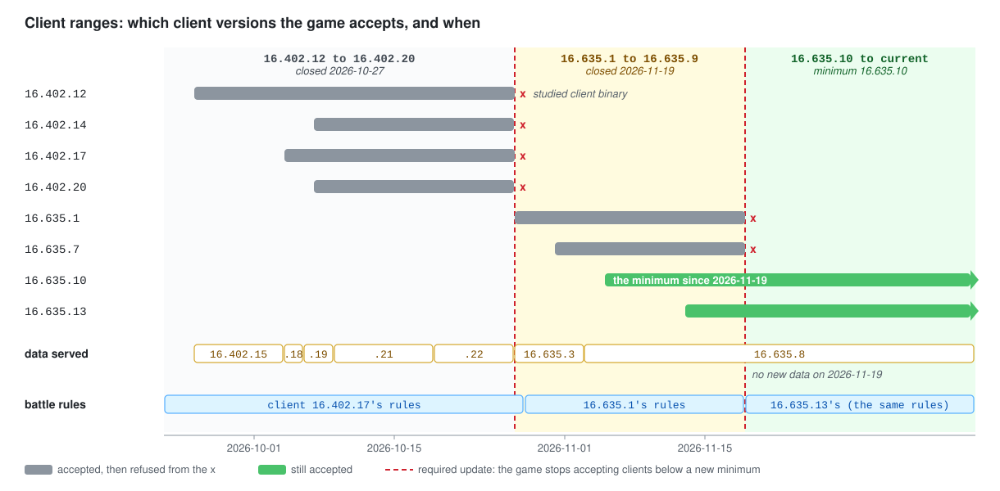

# Compatibility

Which game versions the simulator's battle rules hold for: the client it follows, the client versions that share its rules, and the data it runs. The versions the game has shipped are recorded in [Game Versions](game-versions.md).

## Client ranges: which client versions share the battle rules

The game updates clients in two ways:

- **Optional update.** The game offers a newer version, but a player can decline it, keep logging in on the older version, receive the new data and keep playing.
- **Required update.** Older clients can no longer log in until they update. A required update can come with a new patch of the same `major.minor` as well as with a new `major.minor`.

So at any time the game accepts a range of client versions, from a minimum to the newest. Players on different versions of that range meet in the same battle, and a battle has to play out the same for both of them, so the versions of one range share the battle rules. A change to the rules comes with a required update, which raises the minimum and starts a new range. This is inferred from how the game handles updates, not from comparing the clients' code.

It follows for the data too. The game only serves a data version to clients that can play it, so every data version served while a range is live runs on that range's rules: the data versions compatible with a client are the ones served to any client of its range, from the range's start until a required update ends it.

Each bar runs from the day a client version was first seen to the required update the game server refused it from; the ranges, the data served and the battle rules followed are the ones in the tables below.

## Reference client: 16.635.13

The simulator's battle rules follow client 16.635.13 (`GameVersions.CLIENT_16_635_13`), from 2026-11-19. What it is compatible with:

### Client range: 16.635.10 to current

| Client version | Seen as | First seen |
| --- | --- | --- |
| 16.635.10 | released on Google Play, on data version 16.635.8 (no new data version came with it); an optional update while client 16.635.1 was still accepted, and the range's minimum since 2026-11-19 | 2026-11-05 |
| 16.635.13 | the reference client, installed on a test phone; released on 2026-11-13, on data version 16.635.8 (no new data version came with it); an optional update while client 16.635.1 was still accepted | 2026-11-13 |

The range's minimum was checked against the game server on 2026-11-19: it refused clients 16.635.1 to 16.635.9 with the update-required status and accepted 16.635.10. It accepted every patch tried above that too, 16.635.11, .12, .14, .15, .16, .20 and .50 included, which are not known as released clients, so the server checks only the minimum, as it did for the 16.402 range.

The range began with the required update of 2026-11-19 that closed client 16.635.1's range (below). No new data version came with it: the server still serves data version 16.635.8 to clients of this range. Clients 16.635.10 and 16.635.13 were released while client 16.635.1 was still accepted and met it in the same battles, so by the reasoning above they share its battle rules. The move to 16.635.13 checked it too: client 16.635.13 reads the game data as client 16.635.1 does (its schema facts, `tables/.../schema/16.635.13.json`, equal 16.635.1's), and it plays every reference battle of 16.635.8 the same, tick for tick, as client 16.635.1 recorded it.

Every data version served to a client of this range is compatible; the pairs are in [Game Versions](game-versions.md). `GameVersions.CLIENT_16_635_13_DATA` lists the ones the simulator has game tables for (16.635.8), and CI tests each of them (`compatible` in `crforge-data.lock`). Its reference battles are the game's own recordings on 16.635.8: every listing recorded on 16.635.3, recorded again on 16.635.8, and the cases recorded since. CI holds them to `conformance/reference-expectations/16.635.8.json` and scores 16.635.8's coverage set after each merge ([conformance](../conformance/README.md#coverage)).

## Former reference client: 16.635.1

The simulator's battle rules followed client 16.635.1 from 2026-10-28 until 2026-11-19. What it was compatible with:

### Client range: 16.635.1 to 16.635.9 (closed 2026-11-19)

| Client version | Seen as | First seen |
| --- | --- | --- |
| 16.635.1 | the reference client, installed on a test phone; refused by the game server since 2026-11-19 | 2026-10-27 |
| 16.635.7 | an optional update: client 16.635.1 logged in and played without it, data version 16.635.8 included; refused by the game server since 2026-11-19 | 2026-10-31 |

The range's minimum was not checked against the game server while it was open.

**No longer accepted since 2026-11-19.** The range closed with a required update: the game stopped accepting clients 16.635.1 to 16.635.9 between 2026-11-18 09:07 UTC, when client 16.635.1 last logged in, and 2026-11-19 06:03 UTC, when the game server refused it with the update-required status. The simulator's state at the closure is the release [v16.635.1-range-16.635.1-16.635.9](https://github.com/voonhous/crforge/releases/tag/v16.635.1-range-16.635.1-16.635.9); the simulator moved to client 16.635.13 the same day (above).

Every data version served to a client of this range was compatible: 16.635.3 and 16.635.8, both with game tables and reference battles. 16.635.8 carries on into the next range. 16.635.3 was never served to a client of the next range, so it left `compatible` in `crforge-data.lock` with the move, and its expectation file and coverage badge went with it; `GameVersions.DATA_16_635_3` stays as the data version whose replays decided client 16.635.1's replay fields. The release above plays it.

## Former reference client: 16.402.17

The simulator's battle rules followed client 16.402.17 (`GameVersions.CLIENT_16_402_17`) until 2026-10-28. What it was compatible with:

### Client range: 16.402.12 to 16.402.20 (closed 2026-10-27)

| Client version | Seen as | First seen |
| --- | --- | --- |
| 16.402.12 | a studied client binary | 2026-09-25 |
| 16.402.14 | an installed client on a test phone, offered the optional update on 2026-10-07 | 2026-10-07 |
| 16.402.17 | the reference client | 2026-10-04 |
| 16.402.20 | the App Store's version in most countries (released 2026-10-07 08:50 UTC) | 2026-10-07 |

The range's minimum was checked against the game server on 2026-10-26: it refused client 16.402.11 with an update-required status and accepted 16.402.12. It accepted every patch tried above that too, 16.402.13, .15 and .21 included, which are not known as released clients, so the server checks only the minimum; being accepted does not show that a client version exists.

The range closed with a required update on 2026-10-27: the game server refused client 16.402.21, which it had accepted the day before, with the update-required status. The server checks only a minimum, so every client of the range is refused. Client 16.635.1 was first seen the same day, installed on a test phone (pairs in [Game Versions](game-versions.md)). The simulator's last state on this range is the release [v16.402.17-range-16.402.12-16.402.20](https://github.com/voonhous/crforge/releases/tag/v16.402.17-range-16.402.12-16.402.20); the simulator moved to it on 2026-10-28 (above).

Every data version served to a client of this range was compatible; the pairs are in [Game Versions](game-versions.md). The simulator had game tables and reference battles for 16.402.18, 16.402.19, 16.402.21 and 16.402.22 (`GameVersions.CLIENT_16_402_17_DATA`, still named by the replay reading). CI no longer tests them: they left `compatible` in `crforge-data.lock` when the simulator moved to client 16.635.1, and their expectation files and coverage badges went with them. The release above plays them.

## Keeping this page

- Add a client version to the reference client's range when it is first seen.
- When the range's minimum is checked again, replace the date and the versions of the last check.
- A new data version goes into its range's pairs table in [Game Versions](game-versions.md); it is compatible when it is served to a client of the range.
- A required update closes the reference client's range: record it, and start a new reference client section for the new range when the simulator moves to it.
- A required update that only raises the minimum, when the clients from the new minimum on were released while the reference client was still accepted, carries the battle rules on: those clients played the same battles as the reference client. Move the reference to a client of the new range once it is shown to read the game data and play the reference battles as the old one did, and drop the data versions never served to the new range (as 16.635.13 and 16.635.3 on 2026-11-19).
- Redraw the timeline (`assets/compatibility/client-ranges.svg`) when a client version is first seen, a data version is served or a range closes.
