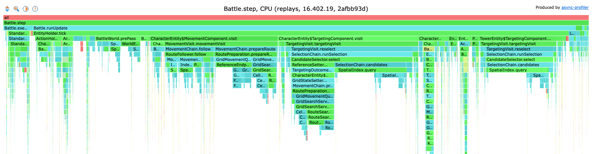
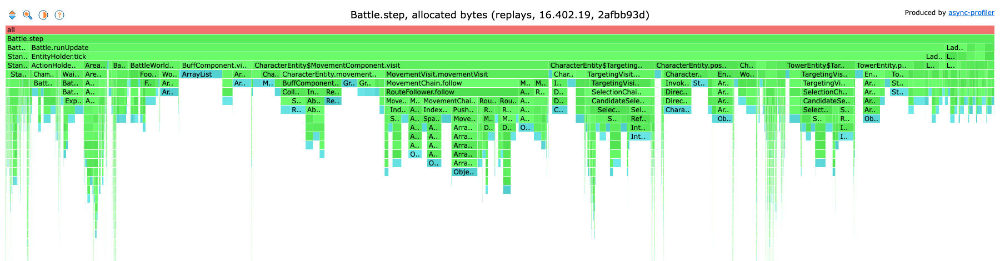
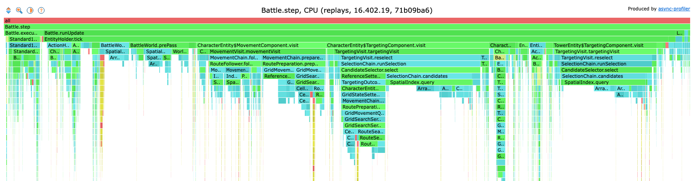
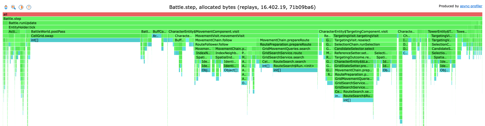

# Performance history

The battle core's earlier baselines and each round of optimisations, newest first, kept with their numbers and profiles. The benchmark, its workloads and the profiler commands are described in [Performance](performance.md), which also holds the current baseline.

## The sixth optimisations (2026-10-28)

The first round on Java 21 (#765), on the same 674 battles of 16.635.3 as [the fifth](#the-fifth-optimisations-2026-10-28), every change held to the observations of all 674 battles hashing byte-identical to its base, alone and together.

The start, a full benchmark of main eb8c7da3 on JDK 21.0.9: `replays` 117,122 +- 6,663 steps a second, `allCases` 108,279 +- 4,871, `allCasesFourThreads` 451,725 +- 13,743, about 7.3 KB a step: the same as [823b578b on JDK 17](#baseline-after-the-fifth-optimisations-2026-10-28) within the error. What its profile of the replays showed (9,978 CPU samples inside the steps):

| Share of step time | Where |
|--------------------|-------|
| 32% | choosing targets (`TargetingVisit.reselect` 28%); the six towers alone 10% |
| 21% | preparing routes: the route search 14%, the scan for the cell to walk to 6.5% |
| 17% | `SpatialIndex.query`: its own walk over the buckets 9.5% |
| 13% | the world's pre-pass: every entity's candidates registered 6%, each one an identity map lookup per entity listed, every step |
| 9% | following routes |
| 4% | the lane of each new unit and of each card's drop point: a scan of all 2,304 cells of the map |
| 1.2% | the crown towers moved to the end of a candidate list one at a time (`SpatialIndex.moveKingsLast`) |

Each change back to back against main, `replays` only, 3 forks x 5 iterations of 2 s:

| Change | ticks/s | Allocated a step |
|--------|---------|------------------|
| main eb8c7da3 | 120,569 +- 5,360 | 7.16 KB |
| only the arrivals registered as candidates at each pre-pass (#766), first version | 123,741 +- 4,145 | 7.62 KB |
| each entity tested once in a spatial query (#767) | 122,203 +- 3,045 | 7.22 KB |
| lanes searched over the map's road cells only (#768) | 123,834 +- 4,043 | 7.24 KB |
| only the cell states cleared between route searches (dropped) | 120,383 +- 4,562 | 7.20 KB |
| the arena lists copied only for the world's observers (#769) | 120,182 +- 4,157 | 6.92 KB |
| the crown towers moved last in one pass (dropped) | 121,845 +- 2,726 | 7.35 KB |
| all six | 130,770 +- 9,666 | 7.55 KB |
| main eb8c7da3 again | 119,328 +- 4,677 | 7.19 KB |

- The arrivals only: a registration is dropped only when its entity leaves the battle, so an entity that registered the whole list at the last pre-pass can miss only the entities listed since. The first version walked the lists with enhanced for loops in the new path and allocated 0.45 KB more a step (iterators JDK 21 kept); walked by index, 125,185 +- 5,974 steps a second and 7.30 KB against main's 122,046 and 121,477.
- Each entity tested once: the candidate query tested an entity it rejected again in every further bucket it reaches; the tests read the entity and the query only, so the second answered as the first. The query's shape tests went from 1.9% to 1.1% of step time.
- The road cells: 692 of the 2,304 cells; the lane went from 3.8% to 0.3% of step time.
- The observers' copies: no speed, 3.5% fewer bytes; kept as it costs nothing.
- Dropped: clearing only the states moved nothing beyond the error, and `moveKingsLast` took 1.4% of step time before and after the one-pass version, its cost being the walk over the list, not the moves.
- The spread of each run is mostly the battles each 2 s iteration happens to cover: the iterations of one run rise and fall alike in every fork, so runs are compared by their means.

The four kept together against main, alternating: 121,291 then 131,207, 118,045 then 126,127 steps a second; the means 119,668 and 128,667 (+7.5%), 7.2 and 7.0 KB a step.

The round as a whole, full benchmark of eb8c7da3 against d7aaec93 ([the current baseline](performance.md#baseline-2026-10-28)), both on JDK 21.0.9: `replays` 117,122 to 126,720 steps a second (+8.2%), `allCases` 108,279 to 122,274 (+12.9%), `allCasesFourThreads` 451,725 to 503,698 (+11.5%), about 7.3 to 7.0 KB a step.

## The fifth optimisations (2026-10-28)

The first round on data 16.635.3, after the move to client 16.635.1. With no reference battles of 16.635.3 yet, the workload is 674 real Ladder battles of 16.635.3 from anonymized copies (see [A data version without references](performance.md#a-data-version-without-references)), and every change was held to the observations of all 674 battles hashing byte-identical to its base, alone and together. Measured back to back on JDK 17.0.14, `replays` only, 2 forks x 5 iterations of 10 s unless said; on this workload one iteration of 2 s covers only about 55 battles, and the error is about +-7% from the mix of battles alone, so a single change's speed is read only together with others.

First four changes, from the profile at 91bccf5f (below), each its own PR and claimed by its allocation:

| Change | Allocated a step (2 s iterations, base 14.25 KB) |
|--------|-------------------------------------------------|
| the champion views built only for an observer that reads them (#753) | 13.77 KB (-3.5%) |
| movement chains record no marker names, one state visit list per entity (#754) | 11.84 KB (-17%) |
| each unit's state visit answers reused across steps (#755) | 12.14 KB (-15%) |
| the buff speed percents and hit list check without streams and boxing (#756) | 12.37 KB (-13%) |

The four together against 91bccf5f, in alternating pairs: 100,647 +- 5,429 then 112,074 +- 6,394 steps a second (+11.4%, load about 3), 96,865 +- 8,240 then 109,802 +- 6,338 (+13.4%, load 6 to 8); 14.6 then 8.0 KB a step.

Moving the build to JDK 21 was measured next (#758): on the same source JDK 21 ran 2% to 6% fewer steps a second before the four changes and about the same after, but allocated about 12% more a step either way. With escape analysis off both JDKs allocate the same, so the extra bytes are short-lived objects JDK 17's compiler removes and JDK 21's keeps: iterators, the query lists, small records. Three more changes, against main 20f080dc:

| Source | JDK | ticks/s | Allocated a step |
|--------|-----|---------|------------------|
| main 20f080dc | 17 | 110,107 +- 7,955 | 8.07 KB |
| the standard records shared (#762) | 17 | 107,315 +- 6,731 | 8.26 KB |
| the hottest per-step lists walked by index (#763) | 17 | 109,155 +- 8,747 | 7.59 KB |
| the hottest spatial queries answered into reused lists (dropped) | 17 | 102,022 +- 6,845 | 6.42 KB |
| all three | 17 | 104,692 +- 7,086 | 5.85 KB |
| main 20f080dc again | 17 | 109,060 +- 8,048 | 7.91 KB |
| main 20f080dc | 21 | 107,036 +- 6,092 | 8.60 KB |
| all three | 21 | 107,393 +- 7,738 | 5.78 KB |

- The standard records shared: six factories built an immutable constant record on every call. JDK 17 already removed these objects, JDK 21 often did not inline the call and allocated them.
- The hottest lists walked by index: nine loops over `ArrayList`s that nothing changes while they are walked, so no iterator is made for the compiler to remove.
- The reused query lists were dropped: 20% fewer bytes, but 1.5% to 3.3% fewer steps a second in four alternating pairs against their base, in two versions (the bucket walk shared with `query`, and `query` untouched with a separate walk). The likely cost, not proven: a reused list soon lives in the old generation, so every reference written into it pays the collector's write barrier and every clear writes the whole array, while a fresh list stays young and dies for free. Garbage collection takes tens of milliseconds over a whole benchmark here, so bytes alone buy no speed.

The round as a whole, full benchmark of 91bccf5f against 823b578b ([its baseline](#baseline-after-the-fifth-optimisations-2026-10-28)): `replays` 103,994 to 118,097 steps a second (+13.6%), `allCases` 96,451 to 111,249 (+15.3%), `allCasesFourThreads` 405,086 to 449,622 (+11.0%), about 14.2 to 7.0 KB a step.

## Baseline after the fifth optimisations (2026-10-28)

The baseline of the fifth optimisations, on Java 17, that the sixth started from:

- Source `main` 823b578b, after the fifth optimisations (see [The fifth optimisations](#the-fifth-optimisations-2026-10-28)).
- Data version 16.635.3. It has no reference battles yet, so the workload is 674 real Ladder battles of 16.635.3, played from anonymized copies kept outside the repositories and laid out as a references folder (see [A data version without references](performance.md#a-data-version-without-references)). The battle core refuses none of them, and all are replays, so `allCases` runs the same battles as `replays` in another order.
- Java 17.0.14 (Temurin), Apple M4 Pro (10 performance and 4 efficiency cores), 48 GB.
- JMH defaults as in [The benchmark](performance.md#the-benchmark). Score and error as JMH prints them.
- Load average 3.5 to 7.3 during the run, the four-thread workload's own threads included.

| Workload | Threads | ticks/s | battles/s | Allocated per battle | Allocated per tick |
|----------|---------|---------|-----------|----------------------|--------------------|
| `replays` | 1 | 118,097 +- 6,346 | 32.25 +- 2.16 | 26.3 MB | about 7.0 KB |
| `allCases` | 1 | 111,249 +- 6,545 | 27.62 +- 2.09 | 30.8 MB | about 7.4 KB |
| `allCasesFourThreads` | 4 | 449,622 +- 11,361 | 108.72 +- 3.49 | 31.0 MB | about 7.2 KB |

Read as:

- A real battle runs at about 118,000 steps a second on one thread, about 5,900 times the game's own 20 steps a second: a battle of about 4,000 steps (the workload's average) in about 34 ms.
- Four threads give 4.0 times one thread.
- These numbers are of other battles than the 2026-10-11 baseline (16.402.19, 25 replays), so the two are not comparable. On this workload the round took the replays from 103,994 to 118,097 steps a second (+13.6%) and the bytes from about 14.2 KB a step to 7.0 KB.

What the profile of the replays shows at this baseline (async-profiler, as in [Profiling](performance.md#profiling), about 10,000 CPU samples inside the steps, load average about 3.3):

| Share of step time | Where |
|--------------------|-------|
| 34% | choosing targets (`TargetingVisit.reselect` 29%, `SelectionChain`); the six towers alone 11% |
| 18% | `SpatialIndex.query` (most of it inside the above, the rest in the push and avoidance passes): its own walk over the buckets 10% |
| 22% | preparing routes (`RoutePreparation`): the route search 14%, the scan for the cell to walk to (`ReferenceEndpoint`) 7% |
| 10% | following routes |
| 10% | the world's pre-pass (`BattleWorld.prePass`): every entity's candidates registered 4%, the spatial index rebuilt 3% |
| 4% | the commands, nearly all card plays |
| 2% | the holder's cleanup |
| 2% | action rows built per target of an area hit (`ActionRows.build`, mostly from `AreaEffectEntity`) |

The champion views (2.4% at the round's start) have left the profile. The bytes allocated: `SpatialIndex.query`'s result lists 17%, `SelectionChain.views` 5%, `CharacterEntity.movementQueries` 5%, `ResumeHelper.resume` 4%, `IndexNeighbourQuery.near` 4%, `BattleWorld.present` 4%, `GridMovementQueries` 4%. Reusing the query result lists was tried and dropped: fewer bytes, fewer steps a second (see [The fifth optimisations](#the-fifth-optimisations-2026-10-28)).

## Baseline at 91bccf5f (2026-10-28)

The start of the fifth optimisations, the first baseline of 16.635.3:

- Source `main` 91bccf5f, on client 16.635.1 and data 16.635.3.
- The 674 battles of [The fifth optimisations](#the-fifth-optimisations-2026-10-28), all replays, none refused.
- Java 17.0.14 (Temurin), Apple M4 Pro (10 performance and 4 efficiency cores), 48 GB; JMH defaults as in [The benchmark](performance.md#the-benchmark).
- Load average 3.3 to 5.1 during the run.

| Workload | Threads | ticks/s | battles/s | Allocated per battle | Allocated per tick |
|----------|---------|---------|-----------|----------------------|--------------------|
| `replays` | 1 | 103,994 +- 6,354 | 27.76 +- 2.72 | 54.8 MB | about 14.2 KB |
| `allCases` | 1 | 96,451 +- 2,952 | 24.17 +- 1.29 | 59.4 MB | about 14.5 KB |
| `allCasesFourThreads` | 4 | 405,086 +- 11,013 | 97.72 +- 5.30 | 59.8 MB | about 13.9 KB |

What the profile of the replays showed (async-profiler, as in [Profiling](performance.md#profiling), 10,087 CPU samples inside the steps):

| Share of step time | Where |
|--------------------|-------|
| 30% | choosing targets (`TargetingVisit.reselect` 26%); the six towers alone 9.5% |
| 15% | `SpatialIndex.query`: its own walk over the buckets 8% |
| 19% | preparing routes: the route search 12%, the scan for the cell to walk to 6% |
| 12% | following routes |
| 9% | the world's pre-pass |
| 3% | the champion slots' step, nearly all a list of champion views built every step from a walk over every entity |
| 2% | action rows built per target of an area hit (`ActionRows.build`) |
| 2% | the `WaitToActivate` action's expression, evaluated every step |

The bytes: `MovementChain.mark` 9.4%, `CharacterEntity.stateQueries` 9.3%, `SpatialIndex.query` 8.0%, `BuffComponent.speedPercents` 7.6% (streams), `ReferenceValidator.validate` 5.1% (boxed ids), `EntityStateVisit.stateVisit` 4.1%, `StateQueries.withMayHoldRoute` 4.0%. By class `Object[]` 30%, `ArrayList` 12%, `StateQueries` 7%, `Integer` 6%. Garbage collection took 52 ms over the whole benchmark.

The memory a battle holds, after full collections with 100 battles held side by side: about 0.11 MB at its first step, 0.35 MB half way and 0.68 MB at its end, the tables (12 MB) shared. It grows because `Standard1v1Battle.plays` keeps every play with the units it placed, so every played unit stays reachable after it dies; projectiles and area effects are released.

## Baseline after the fourth optimisations (2026-10-11)

The baseline of 16.402.19 the fifth optimisations started from, before data 16.635.3 (the next baseline, at 91bccf5f, is of other battles and not comparable):

- Source `battle_core` a606c90c, with the crowns counted without walking every entity and each unit row built once per battle (the fourth optimisations in [the history](#the-fourth-optimisations-2026-10-11)).
- Data version 16.402.19, with the references at the commit `crforge-data.lock` names (599 of 599 cases run, 25 of them replays).
- Java 17.0.14 (Temurin), Apple M4 Pro (10 performance and 4 efficiency cores), 48 GB.
- JMH defaults as in [The benchmark](performance.md#the-benchmark). Score and error as JMH prints them.
- Load average 3.4 to 5.8 during the run, the four-thread workload's own threads included.

| Workload | Threads | ticks/s | battles/s | Allocated per battle | Allocated per tick |
|----------|---------|---------|-----------|----------------------|--------------------|
| `replays` | 1 | 104,290 +- 1,193 | 23.14 +- 0.36 | 67.2 MB | about 15 KB |
| `allCases` | 1 | 182,162 +- 5,507 | 128.66 +- 3.87 | 14.0 MB | about 10 KB |
| `allCasesFourThreads` | 4 | 704,085 +- 6,456 | 490.22 +- 5.08 | 14.5 MB | about 10 KB |

Read as:

- A real battle runs at about 104,000 steps a second on one thread, about 5,200 times the game's own 20 steps a second: a battle of about 4,500 steps in about 43 ms. The replays alone, run again after the full benchmark, gave 104,509 +- 953.
- Four threads give 3.9 times one thread.

What the profile of the replays shows at this baseline (async-profiler, as in [Profiling](performance.md#profiling), about 10,000 CPU samples inside the steps, load average about 4.5):

| Share of step time | Where |
|--------------------|-------|
| 28% | choosing targets (`TargetingVisit.reselect`, `SelectionChain`) |
| 16% | `SpatialIndex.query` (most of it inside the above, the rest in the push and avoidance passes): its own walk over the buckets 9% |
| 20% | preparing routes (`RoutePreparation`): the route search 13%, the scan for the cell to walk to (`ReferenceEndpoint`) 6% |
| 11% | following routes |
| 11% | the world's pre-pass (`BattleWorld.prePass`): every entity's candidates registered 5%, the spatial index rebuilt 3%, the building footprints drawn 1.5% |
| 5% | the commands, nearly all card plays (each new unit's lane 1%) |
| 4% | the holder's cleanup: the removal rounds 1.6%, and the live list sorted again by id every step, about 1% |
| 2% | the champion controller's list of champion views, built every step from a walk over every entity |

The crowns (0.2%) and the unit rows (0.2%) have left the profile. The bytes allocated are spread as before, no site above 9%: `MovementChain.mark` 8%, `BuffComponent.visit` 8%, `CharacterEntity.stateQueries` 8%, `BuffComponent.speedPercents` 7% (streams), `SpatialIndex.query` 7%, boxed integers in `ReferenceValidator.validate` 4%.

## The fourth optimisations (2026-10-11)

Two more from the ranked list of the profile at a606c90c, measured back to back against `battle_core` a606c90c (599 cases of 16.402.19, 25 of them replays): the full benchmark of each source in turn, then the replays alone again in the same order. Load average 1.9 to 4.7 during the full runs, the four-thread workload's own threads included, and 2.4 to 9.2 during the replays alone (the machine was busier then).

| Source | `replays` ticks/s | `replays` again | `allCases` ticks/s | `allCasesFourThreads` ticks/s | Allocated per battle, `replays` | `allCases` |
|--------|-------------------|-----------------|--------------------|-------------------------------|---------------------------------|------------|
| before (a606c90c) | 97,498 +- 4,776 | 102,320 +- 1,156 | 175,925 +- 3,787 | 676,067 +- 5,943 | 71.7 MB | 15.4 MB |
| the crowns counted without walking every entity | 102,384 +- 1,343 (+5.0%) | 102,900 +- 1,302 (+0.6%) | 177,355 +- 4,957 (+0.8%) | 695,031 +- 7,976 (+2.8%) | 70.6 MB | 14.8 MB |
| and each unit row built once per battle | 104,290 +- 1,193 (+7.0%) | 104,509 +- 953 (+2.1%) | 182,162 +- 5,507 (+3.5%) | 704,085 +- 6,456 (+4.1%) | 67.2 MB | 14.0 MB |

- The crowns counted without walking every entity: the Ladder match remembers each side's princess towers from its first count and asks the holder whether each is still listed, a binary search by id, instead of walking the whole live list several times a step. The world remembers each side's king tower likewise. The base's first `replays` round has a wide error. Against its second the gain is within the error.
- Each unit row built once per battle: the battle's records built a unit from its row on every ask, for every card play (through the card and its champion) and every spawn. A unit is immutable, so the first build per name now stands for every later ask. Both together run above 100,000 steps a second on the replays in both rounds.

## Baseline at a606c90c (2026-10-11)

The baseline after the third optimisations, kept with its profile:

- Source `battle_core` 594d47d6, with the endpoint scan's tests skipped for a cell that cannot win and each side's king tower remembered (the third optimisations, below).
- Data version 16.402.19, with the references at the commit `crforge-data.lock` names (599 of 599 cases run, 25 of them replays).
- Java 17.0.14 (Temurin), Apple M4 Pro (10 performance and 4 efficiency cores), 48 GB.
- JMH defaults as in [The benchmark](performance.md#the-benchmark). Score and error as JMH prints them.
- Load average 3.2 to 4.6 during the run, the four-thread workload's own threads included.

| Workload | Threads | ticks/s | battles/s | Allocated per battle | Allocated per tick |
|----------|---------|---------|-----------|----------------------|--------------------|
| `replays` | 1 | 98,469 +- 4,963 | 21.86 +- 1.06 | 71.5 MB | about 16 KB |
| `allCases` | 1 | 169,260 +- 4,739 | 119.33 +- 4.70 | 15.7 MB | about 11 KB |
| `allCasesFourThreads` | 4 | 677,451 +- 6,836 | 469.51 +- 4.17 | 15.3 MB | about 11 KB |

Read as:

- A real battle runs at about 98,000 steps a second on one thread, about 4,900 times the game's own 20 steps a second: a battle of about 4,500 steps in about 46 ms.
- Four threads give 4.0 times one thread.

What the profile of the replays shows at this baseline (async-profiler, as in [Profiling](performance.md#profiling), about 10,000 CPU samples inside the steps, load average about 3.5):

| Share of step time | Where |
|--------------------|-------|
| 26% | choosing targets (`TargetingVisit.reselect`, `SelectionChain`) |
| 16% | `SpatialIndex.query` (most of it inside the above, the rest in the push and avoidance passes): its own walk over the buckets 9% |
| 19% | preparing routes (`RoutePreparation`): the route search 12%, the scan for the cell to walk to (`ReferenceEndpoint`) 6% |
| 10% | following routes |
| 10% | the world's pre-pass (`BattleWorld.prePass`): every entity's candidates registered 4%, the spatial index rebuilt 2%, the building footprints drawn 1.5% |
| 7% | the commands, nearly all card plays: a play builds its card's unit rows again (1%) and finds each new unit's lane (1%) |
| 2% | `LadderMatch.crowns`, a walk over every entity for the princess towers, several times a step |
| 2% | the champion controller's list of champion views, built every step from a walk over every entity |

The bytes allocated are spread as before, no site above 9%: `MovementChain.mark` 8%, `BuffComponent.visit` 8%, `CharacterEntity.stateQueries` 7%, `SpatialIndex.query` 7%, `BuffComponent.speedPercents` 7% (streams), boxed integers in `ReferenceValidator.validate` 4%.

## The third optimisations (2026-10-11)

Two smaller changes from the ranked list of the profile at 8c51ccfb, measured back to back against `battle_core` 594d47d6 (the baseline's code, 599 cases of 16.402.19, 25 of them replays): the full benchmark of each source in turn, then the replays alone again in the same order. Load average 3.2 to 6.2 during the full runs, the four-thread workload's own threads included, and 1.5 to 2.8 during the replays alone.

| Source | `replays` ticks/s | `replays` again | `allCases` ticks/s | `allCasesFourThreads` ticks/s | Allocated per battle, `replays` | `allCases` |
|--------|-------------------|-----------------|--------------------|-------------------------------|---------------------------------|------------|
| before (594d47d6) | 92,102 +- 1,049 | 93,504 +- 1,150 | 156,449 +- 5,440 | 615,151 +- 12,756 | 76.5 MB | 16.5 MB |
| the endpoint scan's tests skipped for a cell that cannot win | 95,417 +- 1,799 (+3.6%) | 95,060 +- 1,189 (+1.7%) | 163,173 +- 9,357 (+4.3%) | 640,381 +- 7,874 (+4.1%) | 76.1 MB | 16.4 MB |
| and each side's king tower remembered | 98,469 +- 4,963 (+6.9%) | 97,793 +- 3,579 (+4.6%) | 169,260 +- 4,739 (+8.2%) | 677,451 +- 6,836 (+10.1%) | 71.5 MB | 15.7 MB |

- The endpoint scan's tests skipped for a cell that cannot win: once the best cell of the scan for the cell a unit walks to is of the preferred rank, a cell no nearer to the unit cannot beat it. So its distance to the target and its rank are not asked. The acceptance test is still asked of every cell.
- Each side's king tower remembered: the Ladder match looked its kings up in the holder's live list several times a step (the crowns, whether a king is alive, the tiebreaker). A king tower never leaves the holder, so the first lookup is kept. It also saves each lookup's iterator: the replays allocated 76.1 MB a battle before it and 71.5 MB after, in the first round (80.7 and 73.2 MB in the second). The spread from run to run is about 4%.

## Baseline at 287b0c7d (2026-10-11)

The baseline after the second optimisations, kept with its profile:

- Source `battle_core` 8c51ccfb, with the slot marks of the spatial index and the route search's cells priced as it reaches them (the second optimisations, below).
- Data version 16.402.19, with the references at the commit `crforge-data.lock` names (544 of 544 cases run, 24 of them replays).
- Java 17.0.14 (Temurin), Apple M4 Pro (10 performance and 4 efficiency cores), 48 GB.
- JMH defaults as in [The benchmark](performance.md#the-benchmark). Score and error as JMH prints them.
- Load average 4.1 to 6.3 during the run, the four-thread workload's own threads included.

| Workload | Threads | ticks/s | battles/s | Allocated per battle | Allocated per tick |
|----------|---------|---------|-----------|----------------------|--------------------|
| `replays` | 1 | 92,834 +- 1,086 | 20.40 +- 0.30 | 77.9 MB | about 17 KB |
| `allCases` | 1 | 158,199 +- 4,812 | 108.33 +- 4.15 | 17.0 MB | about 12 KB |
| `allCasesFourThreads` | 4 | 624,528 +- 11,867 | 422.89 +- 10.50 | 17.2 MB | about 12 KB |

Read as:

- A real battle runs at about 93,000 steps a second on one thread, about 4,600 times the game's own 20 steps a second: a battle of about 4,550 steps in about 49 ms.
- Four threads give 3.9 times one thread.

What the profile of the replays showed at 8c51ccfb, just before the second optimisations (async-profiler, as in [Profiling](performance.md#profiling), about 20,000 CPU samples inside the steps, on a busy machine: the shares hold, the speed does not):

| Share of step time | Where |
|--------------------|-------|
| 31% | choosing targets (`TargetingVisit.reselect`, `SelectionChain`) |
| 17% | `SpatialIndex.query` (inside the above, and the push and avoidance passes): 7% of it the look through its result for an entity already accepted, the walk over the buckets cheap since #482 |
| 22% | preparing routes (`RoutePreparation`): the route search 9%, the cost field priced for the whole arena before each search 5%, the scan for the cell to walk to (`ReferenceEndpoint`) 7% |
| 10% | following routes |

The bytes allocated are spread as at 2afbb93d: no site above 8%.

## The second optimisations (2026-10-11)

The changes the profile at 8c51ccfb pointed to, measured back to back against 8c51ccfb on the same references (544 cases): the full benchmark of each source in turn, then the replays alone again in the same order. Load average 2.4 to 8.0, the four-thread workload's own threads included.

| Source | `replays` ticks/s | `replays` again | `allCases` ticks/s | `allCasesFourThreads` ticks/s | Allocated per battle, `replays` | `allCases` |
|--------|-------------------|-----------------|--------------------|-------------------------------|---------------------------------|------------|
| before (8c51ccfb) | 81,692 +- 1,362 | 83,219 +- 1,069 | 145,533 +- 8,347 | 559,708 +- 15,915 | 78.3 MB | 17.0 MB |
| slot marks in the spatial index | 88,286 +- 1,451 (+8.1%) | 90,217 +- 923 (+8.4%) | 155,654 +- 4,408 (+7.0%) | 606,776 +- 9,557 (+8.4%) | 81.9 MB | 16.9 MB |
| and the cells priced as the search reaches them | 92,834 +- 1,086 (+13.6%) | 93,712 +- 1,060 (+12.6%) | 158,199 +- 4,812 (+8.7%) | 624,528 +- 11,867 (+11.6%) | 77.9 MB | 17.0 MB |

- Slot marks in the spatial index: each entity put in the index takes a slot and the buckets hold slots. A query marks the slots it has accepted in a word per 64 slots instead of looking through its result for every entry it meets.
- The cells priced as the search reaches them: the route search prices a cell from the cost lookup the first time it reads it, instead of all 2304 cells of the arena before every search. On top of the slot marks it adds about 4 to 5% on the replays. On all the cases, whose battles are mostly short, it adds less than its error.

The bytes allocated did not move beyond the spread from run to run (about 4%): the changes save time, not objects.

## Baseline at 2afbb93d (2026-10-10)

The baseline after the first optimisations, kept with its profile:

- Source `battle_core` 2afbb93d.
- Data version 16.402.19, with the references at the commit `crforge-data.lock` names (459 of 459 cases run, 24 of them replays).
- Java 17.0.14 (Temurin), Apple M4 Pro (10 performance and 4 efficiency cores), 48 GB.
- JMH defaults as in [The benchmark](performance.md#the-benchmark). Score and error as JMH prints them.
- Load average 2.3 to 4.1 during the run.

| Workload | Threads | ticks/s | battles/s | Allocated per battle | Allocated per tick |
|----------|---------|---------|-----------|----------------------|--------------------|
| `replays` | 1 | 74,079 +- 1,058 | 16.30 +- 0.34 | 80.4 MB | about 18 KB |
| `allCases` | 1 | 123,433 +- 7,653 | 81.46 +- 8.86 | 18.1 MB | about 12 KB |
| `allCasesFourThreads` | 4 | 494,770 +- 10,458 | 320.26 +- 6.24 | 17.8 MB | about 12 KB |

Read as:

- A real battle runs at about 74,000 steps a second on one thread, about 3,700 times the game's own 20 steps a second: a battle of about 4,550 steps in about 61 ms.
- Four threads give 4.0 times one thread: linear.
- The collector costs 48 ms over the 30 measured seconds of `replays` (0.16%).

What the profile of the replays shows (async-profiler, as in [Profiling](performance.md#profiling), about 10,000 CPU samples inside the steps):

| Share of step time | Where |
|--------------------|-------|
| 34% | choosing targets (`TargetingVisit.reselect`, `SelectionChain`), most of it in `SpatialIndex.query` |
| 26% | `SpatialIndex.query` (inside the above): mostly its own walk over the buckets (14%) and the look through its result for an entity already accepted (5%) |
| 21% | preparing routes (`RoutePreparation`), 8% of it the route search |
| 8% | following routes |

Of the bytes allocated, 98% are allocated in the steps, and no one site holds more than 8% of them: small lists, their iterators, boxed integers, lambdas and streams across the step (`MovementChain.mark` 7.5%, `CharacterEntity`'s lambdas 5.2%, `SpatialIndex.query`'s result lists 4.5%, boxed integers in `ReferenceValidator.validate` 4.3%, `BuffComponent.visit`'s lists 4.3%).

The flame graphs of that profile, cut to `Battle.step` (the benchmark's own frames left out, classes without their packages) and drawn root first: the width of a frame is its share of the step time or of the bytes allocated. The interactive pages come from the commands in [Profiling](performance.md#profiling).

CPU:

Allocated bytes:

## The first optimisations (#478, #479, #480)

The three changes the first profile pointed to, each measured on its own and all three together, back to back against the source before them (81565a2e) on the same references (459 cases), single-thread workloads, load average 2.2 to 7.3:

| Source | `replays` ticks/s | `allCases` ticks/s | Allocated per battle, `replays` | `allCases` |
|--------|-------------------|--------------------|---------------------------------|------------|
| before (81565a2e) | 60,360 +- 1,956 | 95,087 +- 6,428 | 181.2 MB | 40.5 MB |
| #478: the routing overlay's two arrays rotated | 60,959 +- 2,095 | 93,659 +- 6,088 | 140.8 MB (-22%) | 26.3 MB (-35%) |
| #479: spatial queries without a set or iterators | 72,538 +- 1,004 (+20%) | 120,746 +- 8,139 (+27%) | 158.7 MB (-12%) | 36.5 MB (-10%) |
| #480: the route search's arrays kept | 59,814 +- 1,220 | 94,183 +- 6,045 | 144.1 MB (-20%) | 35.7 MB (-12%) |
| all three (2afbb93d) | 72,699 +- 1,133 (+20%) | 124,019 +- 6,959 (+30%) | 79.7 MB (-56%) | 17.8 MB (-56%) |

The speed came from the spatial queries. The other two cut the bytes allocated but not the time on one thread, where the collector was already cheap. Together they more than halved the bytes. On four threads the baseline above runs 494,770 steps a second against 370,143 in the first baseline below (+34%, on a slightly different set of references).

## First baseline (2026-10-10, 71b09ba6)

The baseline before the first optimisations, kept with its profile as the picture they started from.

- Source `battle_core` 71b09ba6 (the battle core as it was; the benchmark itself came after).
- Data version 16.402.19, on an earlier set of its references (450 of 451 cases run, 1 refused, 23 replays).
- Java 17.0.14 (Temurin), Apple M4 Pro (10 performance and 4 efficiency cores), 48 GB.
- JMH defaults as in [The benchmark](performance.md#the-benchmark). Score and error as JMH prints them.

The four-thread workload was run again on its own, as the machine was busy during its first run.

| Workload | Threads | ticks/s | battles/s | Allocated per battle | Allocated per tick |
|----------|---------|---------|-----------|----------------------|--------------------|
| `replays` | 1 | 58,622 +- 2,695 | 12.85 +- 0.60 | 185.8 MB | about 41 KB |
| `allCases` | 1 | 88,772 +- 3,770 | 59.90 +- 2.74 | 40.2 MB | about 27 KB |
| `allCasesFourThreads` | 4 | 370,143 +- 9,901 | 241.44 +- 8.49 | 40.8 MB | about 27 KB |

Read as:

- A real battle runs at about 58,600 steps a second on one thread, about 2,900 times the game's own 20 steps a second: a battle of about 4,560 steps in about 78 ms.
- Four threads give about 4.2 times one thread: linear within the error, so at four threads the threads do not yet hold each other back (9.2 GB allocated a second between them).
- Each step allocates tens of kilobytes, about 2.3 GB a second on one thread. The collector itself costs little (106 ms of collection over the 30 measured seconds of `replays`, under 0.5%): the cost is in making and filling the objects.

What the profile of the replays showed then (async-profiler, as in [Profiling](performance.md#profiling), about 9,600 CPU samples inside the steps):

| Share of step time | Where |
|--------------------|-------|
| 35% | choosing targets (`TargetingVisit.reselect`, `SelectionChain`), most of it in `SpatialIndex.query` |
| 28% | `SpatialIndex.query` (inside the above): a new result list and identity set per query, and the iteration over the buckets |
| 18% | preparing routes (`RoutePreparation`), 12% of it the route search |
| 8% | following routes |

Of the bytes allocated, 99% are allocated in the steps (building the battle is under 1%). The largest sites:

- the routing overlay's fresh, zeroed array at the end of every step (`CellGrid.swap`, from `BattleWorld.postPass`: about 23%)
- the route search's arrays, new for every search (`RouteSearch$Run`, `CellCostField.costField`: about 22%)
- `SpatialIndex.query`'s result lists and identity sets (about 15%)

Its flame graphs, cut to `Battle.step` (the benchmark's own frames left out, classes without their packages) and drawn root first: the width of a frame is its share of the step time or of the bytes allocated. The interactive pages come from the commands in [Profiling](performance.md#profiling).

CPU:

Allocated bytes:

