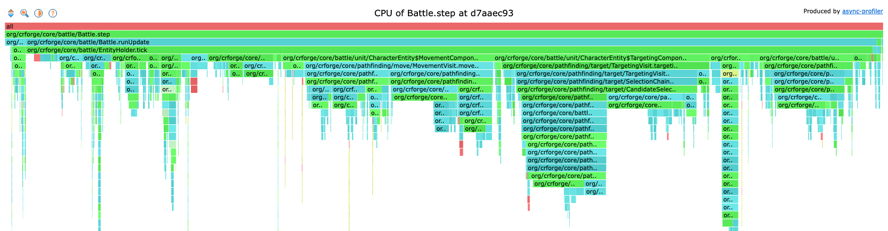
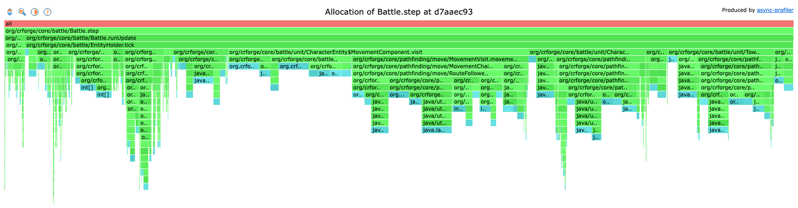

# Performance

How fast the battle core runs, headless: the benchmark, how to profile it, and the baseline the next change is measured against.

**TL;DR:** read `replays` first. It steps real Ladder battles from start to end, so its steps a second are the closest figure to a real game, or to an agent playing one: the production workload.

`allCases` runs about 1.7 times as many steps a second only because most of its cases are short, sparse setups of one mechanic each (see [Why the replays step slower](#why-the-replays-step-slower)). It is a wide check that a change holds up across mechanics, not a speed to expect. On a workload of replays only, like the current baseline's, the two run the same battles and agree.

## The benchmark

`./gradlew :conformance:tickBenchmark -Pcrforge.references=<references folder>` runs `TickBenchmark` (`conformance/src/jmh`) with [JMH](https://github.com/openjdk/jmh). It reads the cases of a references folder as the reference tests do (the tables are the ones the build makes for `-Pcrforge.dataVersion`, which must be the references' version) and translates each case's scenario once.

One operation builds the battle of the next case and steps it until it stops or reaches the case's horizon. Nothing is observed or compared, and nothing outside `core` and `conformance` is loaded: no window, no rendering. A case the battle core refuses is left out and counted.

Three workloads:

- `replays`: the replays of real battles alone (the cases whose scenario is a replay), on one thread. A whole battle with its commands, the closest to a real game.
- `allCases`: every case, replays and generated cases, on one thread. The generated cases are mostly short, targeted battles. They run in a fixed shuffled order, since an iteration covers only part of the list and the listing is grouped by corpus.
- `allCasesFourThreads`: every case on four threads: battles side by side. Four threads leave a shared machine room for its other work. More threads give at most proportionally more, as each thread shares the memory bandwidth and the garbage collector with the others (each step allocates).

Each workload runs in 3 fresh JVMs (forks), each with 3 warm-up and 5 measured iterations of 2 seconds, with JMH's allocation profiler (`-prof gc`). A full run takes about 4 minutes, and the results are also written to `conformance/build/jmh/results.json`. `--args` replaces the default options with JMH's own, for example `--args="TickBenchmark.replays -f 1 -prof gc"`.

How to read the output:

| Result | Meaning |
|--------|---------|
| score (`ops/s`) | battles a second |
| `:ticks` | steps a second: the figure to compare, since battles differ in length |
| `:gc.alloc.rate.norm` | bytes allocated per battle; divided by the steps per battle, the bytes per step |
| `:gc.alloc.rate` | megabytes allocated a second |
| error | JMH's 99.9% confidence interval over the 15 measured iterations |

### Why the replays step slower

Steps a second measure the cost of one step, and a step costs more the more there is on the field. The two kinds of case have very different fields (the references of 16.402.19 on 2026-10-11, 599 cases):

| | Replays (25) | Generated cases (574) |
|---|---|---|
| What it is | a real Ladder battle, both players playing cards from the start to the end | a short setup of one mechanic: a unit walking to a tower, an ability, two units meeting |
| Commands (the plays) | median 52, mean 65 | median 3, mean 7 |
| Length | a whole battle: about 4,500 steps a battle on average in the benchmark (3 minutes 45 seconds) | median horizon 1,200 steps (60 seconds); about 1,400 steps a battle on average across `allCases` |

The expensive parts of a step are done per unit and look at the units around it:

- choosing targets (about a third of the step time) runs a spatial query per unit over its neighbours
- preparing routes runs per moving unit
- the push and avoidance passes look at nearby pairs

A step's cost therefore grows with the units on the field, and faster than in proportion where they crowd together. A replay keeps several troops, their projectiles and spells on both sides most of the time, while a generated case is mostly the six towers and a unit or two, whose steps are cheap.

The bytes allocated show the same: about 17 KB a step for the replays against about 12 KB on all the cases, as every live unit allocates its own small lists and queries each step.

So `allCases` averages many cheap steps with the replays' costly ones, and its steps a second come out higher than any real battle runs. A change that speeds up the per-unit work moves `replays` the most.

What it does not measure: the commands of a reference case are all known before the battle starts, so an agent choosing commands as the battle runs (and reading the battle to choose them) costs more than this.

Run it on a quiet machine: other processes on the same cores (a build, recordings) move the numbers far beyond the error JMH reports, the four-thread workload most of all. Compare runs on the same machine only.

### A data version without references

The benchmark reads only what a references folder lists: a corpus listing under `corpora/` (its content version, and per case an id, a folder, the scenario's SHA-256 and a horizon) and each case's `scenario.json`. When a data version has no reference battles yet, any folder in that layout serves, and the baseline of 2026-10-28 is one: real Ladder battles of 16.635.3 from anonymized copies, each case's horizon its replay's own last tick. Such a workload checks no outcome. A change for speed must then show by other means that the battles are unchanged, for example by the observations of every battle (the reference tests' schema) hashing the same before and after.

## Profiling

Profile before changing anything for speed, and benchmark after. A flame graph shows where the steps spend their time and what they allocate, and the benchmark shows whether a change moved the steps a second.

The benchmark runs with [async-profiler](https://github.com/async-profiler/async-profiler) through JMH (`brew install async-profiler` on macOS; on Linux the library is `libasyncProfiler.so`). One run records the CPU samples, one every millisecond, and the allocations of the replays into a JFR file:

```bash
./gradlew :conformance:tickBenchmark -Pcrforge.references=<references folder> \
  --args="TickBenchmark.replays -f 1 -prof async:libPath=$(brew --prefix async-profiler)/lib/libasyncProfiler.dylib;output=jfr;event=cpu;interval=1000000;alloc;dir=$PWD/conformance/build/profile"
```

`jfrconv`, which comes with async-profiler, turns the recording into the two flame graphs, interactive HTML pages:

```bash
J=$(find conformance/build/profile -name '*.jfr')
jfrconv --cpu "$J" conformance/build/profile/cpu.html
jfrconv --alloc "$J" conformance/build/profile/alloc.html
```

The images on these pages are the same graphs rooted at `Battle.step`, as icicles: the collapsed stacks (`jfrconv --cpu -o collapsed`, `jfrconv --alloc --total -o collapsed`) cut to start at `Battle.step` and turned back into a page with `jfrconv --inverted --title "<title>" --minwidth 0.05`, then a screenshot of the page (1800 by 470).

## Baseline (2026-10-28)

The baseline to measure the next change against:

- Source `main` d7aaec93, after the sixth optimisations (see [the history](performance-history.md#the-sixth-optimisations-2026-10-28)).
- Data version 16.635.3. It had no reference battles when the baseline was taken, so the workload is 674 real Ladder battles of 16.635.3, played from anonymized copies kept outside the repositories and laid out as a references folder (see [A data version without references](#a-data-version-without-references)). The battle core refuses none of them, and all are replays, so `allCases` runs the same battles as `replays` in another order.
- Java 21.0.9 (Temurin), Apple M4 Pro (10 performance and 4 efficiency cores), 48 GB.
- JMH defaults as above. Score and error as JMH prints them.
- Load average 4.0 to 9.0 during the run, the four-thread workload's own threads included.

| Workload | Threads | ticks/s | battles/s | Allocated per battle | Allocated per tick |
|----------|---------|---------|-----------|----------------------|--------------------|
| `replays` | 1 | 126,720 +- 7,107 | 34.63 +- 2.24 | 25.7 MB | about 7.0 KB |
| `allCases` | 1 | 122,274 +- 5,391 | 30.38 +- 1.63 | 29.4 MB | about 7.3 KB |
| `allCasesFourThreads` | 4 | 503,698 +- 13,416 | 122.10 +- 5.48 | 29.5 MB | about 7.1 KB |

Read as:

- A real battle runs at about 127,000 steps a second on one thread, about 6,300 times the game's own 20 steps a second: a battle of about 4,000 steps (the workload's average) in about 32 ms.
- Four threads give 4.0 times one thread.
- Against the previous baseline (823b578b, on Java 17, in [the history](performance-history.md#baseline-after-the-fifth-optimisations-2026-10-28)): `replays` 118,097 to 126,720 steps a second (+7.3%), `allCases` 111,249 to 122,274 (+9.9%), `allCasesFourThreads` 449,622 to 503,698 (+12.0%). The move to Java 21 on its own changed none of them beyond the error; the sixth optimisations did.

What the profile of the replays shows at this baseline (async-profiler, as above, 9,943 CPU samples inside the steps):

| Share of step time | Where |
|--------------------|-------|
| 36% | choosing targets (`TargetingVisit.reselect` 31%); the six towers alone 11% |
| 18% | `SpatialIndex.query` (most of it inside the above, the rest in the push and avoidance passes): its own walk over the buckets 11% |
| 25% | preparing routes (`RoutePreparation`): the route search 16%, the scan for the cell to walk to (`ReferenceEndpoint`) 8% |
| 10% | following routes |
| 8% | the world's pre-pass (`BattleWorld.prePass`): the spatial index rebuilt 3%, the building footprints drawn 2% |
| 3% | the holder's cleanup |
| 2% | the commands, nearly all card plays |
| 2% | action rows built per target of an area hit (`ActionRows.build`) |
| 2% | the `WaitToActivate` action's expression, evaluated every step |

Every entity's candidates registered (6% at the round's start, now 0.4%) and the lane of each new unit (4%, now 0.3%) have left the profile. The bytes allocated: `SpatialIndex.query`'s result lists 17%, `SelectionChain.views` 6%, `CharacterEntity.movementQueries` 5%, `ResumeHelper.resume` 5%, `GridMovementQueries` 4%, `IndexNeighbourQuery.near` 4%, `CharacterEntity.movementChain` 4%.





Earlier baselines and each round of optimisations, with the numbers before and after, are in [Performance history](performance-history.md). What a coverage score costs, and how to profile it, is in the conformance module's [README](../conformance/README.md#what-a-score-costs).

## The environment

The reinforcement learning environment (`env`) steps many battles in one call behind direct buffers. Its benchmark, `./gradlew :env:envBenchmark` (JMH), and the numbers it gave are in [The Environment](environment.md#performance). A Ladder decision costs what this page's tick benchmark says for its ticks plus the environment's encoding, masks and tries, which the synthetic engine puts at a few microseconds.
