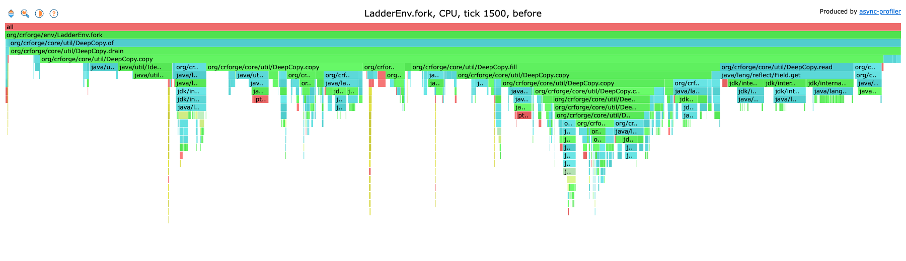
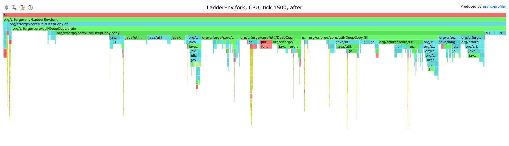

# Fork performance

A log of how fast a fork of a battle is, what was tried to make it faster, and what is left. Newest numbers first, one section per round of work.

**Where it stands (2026-11-12):** a fork takes 0.10 to 0.22 ms, down from 0.29 to 0.72 ms. The goal is under 0.1 ms ([#876](https://github.com/voonhous/crforge/issues/876)), so it is not reached yet for a battle with a full field.

| Age of the battle | Before | After round 1 | Faster by |
|-------------------|--------|---------------|-----------|
| 25 s (tick 500) | 0.29 ms | 0.11 ms | 2.6 times |
| 75 s (tick 1,500) | 0.48 ms | 0.16 ms | 3.0 times |
| 150 s (tick 3,000) | 0.72 ms | 0.20 ms | 3.6 times |

Contents:

- [What a fork is](#what-a-fork-is)
- [How to measure](#how-to-measure)
- [What a fork copies](#what-a-fork-copies)
- [Baseline](#baseline-2026-11-12)
- [Round 1](#round-1-2026-11-12)
- [What is left](#what-is-left)
- [Adding a round](#adding-a-round)

## What a fork is

A search agent asks what an action would lead to before taking it. `LadderEnv.fork` gives it a second battle that is the same as the first at that moment, to play ahead in ([Looking ahead](../environment.md#looking-ahead)).

A fork is a deep copy: every object of the battle is copied once (`DeepCopy`, in `core`'s `util` package). The game tables are not copied. They never change, so the fork and the battle share them.

A search makes many forks per decision, so the cost of one fork is paid many times over.

## How to measure

Three tools, each answering a different question.

| Question | Tool | Command |
|----------|------|---------|
| How long does a fork take, and how much does it allocate? | `ForkBenchmark` (JMH) | `./gradlew :env:envBenchmark --args="ForkBenchmark -prof gc"` |
| Where does the time go? | async-profiler flame graph | see below |
| What is there to copy? | `ForkCensus` | `./gradlew :env:forkCensus` |

**The benchmark.** It plays one Ladder battle to a tick with random plays from a fixed seed, stops it there, and forks it over and over. The score is the microseconds one fork takes on one thread (`us/op`), and `gc.alloc.rate.norm` is the bytes one fork allocates. It runs at three ages of the battle (ticks 500, 1,500 and 3,000), because an older battle has more on the field, and for two kinds of fork (`seat` -1 is the plain copy, `seat` 0 also withdraws the enemy's waiting commands). A full run takes about 3 minutes.

**The flame graph.** The same benchmark under [async-profiler](https://github.com/async-profiler/async-profiler) (`brew install async-profiler` on macOS), sampling the CPU every 0.1 ms:

```bash
./gradlew :env:envBenchmark \
  --args="ForkBenchmark -p tick=1500 -p seat=-1 -f 1 -prof async:libPath=$(brew --prefix async-profiler)/lib/libasyncProfiler.dylib;output=jfr;event=cpu;interval=100000;alloc;dir=$PWD/env/build/profile"
J=$(find env/build/profile -name '*.jfr')
jfrconv --cpu "$J" env/build/profile/cpu.html
jfrconv --alloc --total "$J" env/build/profile/alloc.html
```

`cpu.html` and `alloc.html` are interactive pages: search for `LadderEnv.fork` and click it to see only the fork. The copy calls itself for every object an object holds, so the graph is deep and narrow. The tables of shares on this page are easier to read than the picture; they are the same samples, grouped by what the copy was doing.

**The census.** It counts the objects a fork has to walk, by kind and by class, at the same three ticks. A flame graph says where the time goes. The census says what the battle is made of, which is where ideas for copying less come from.

Run the benchmark on a quiet machine and compare runs on the same machine only. The numbers on this page were taken while other work was running (load average 5 to 9), so read them as ratios; a quiet machine gives lower times.

## What a fork copies

From the census, on data version 16.635.8:

| What | Tick 500 | Tick 1,500 | Tick 3,000 |
|------|----------|------------|------------|
| Objects walked | 3,471 | 4,586 | 5,858 |
| Boxed numbers and strings (kept, never copied) | 1,740 | 1,761 | 1,793 |
| JDK collections (lists, maps, sets) | 518 | 836 | 1,084 |
| Plain objects (units, projectiles, their parts) | 348 | 586 | 845 |
| Records | 249 | 420 | 745 |
| Lambdas that capture state | 212 | 388 | 737 |
| Primitive arrays | 288 | 411 | 511 |
| Elements in those arrays | 30,585 | 35,579 | 38,793 |
| Object arrays | 113 | 181 | 140 |

Things worth knowing from it:

- **The battle is small.** A few thousand objects and about 140 KB of numbers in arrays. Copying that much memory takes a few microseconds. Nearly all of a fork's time is the bookkeeping around the copy, not the copy.
- **Records and lambdas grow fastest with age.** Every card played leaves about eight records behind (the play, its placement, its units), and every unit holds close to 20 lambdas that capture it.
- **A unit carries large records of table values.** Its unit data has 173 components and its targeting configuration 75. They are built when the unit is made and never change after.
- **About 1,650 boxed `Integer`s** sit in the battle's collections. They are kept, but each still has to be looked at.

## Baseline (2026-11-12)

- Source `main` 43552311, data version 16.635.8.
- Java 21.0.9 (Temurin), Apple M4 Pro (10 performance and 4 efficiency cores), 48 GB.
- The benchmark's defaults: 2 JVMs, each 3 warm-up and 5 measured iterations of 2 seconds. Score and error as JMH prints them.

| Tick | Plain fork (`seat` -1) | Seat's fork (`seat` 0) | Allocated per fork |
|------|------------------------|------------------------|--------------------|
| 500 | 291 +- 10 us | 312 +- 12 us | 457 KB |
| 1,500 | 477 +- 101 us | 452 +- 22 us | 635 KB |
| 3,000 | 721 +- 262 us | 655 +- 36 us | 764 KB |

Withdrawing the enemy's commands costs nothing that shows: the two kinds of fork are within each other's error. The work below is measured on the plain fork.

Where the time went, at tick 1,500 (63,000 CPU samples inside `LadderEnv.fork`):

| Share | What the copy was doing |
|-------|-------------------------|
| 32% | Reading the fields of records and lambdas, by reflection |
| 26% | The identity map that remembers each object's copy (growing it alone was 6%) |
| 17% | The copy's own loops |
| 7% | Building records and lambdas, by reflection |
| 5% | Asking whether an object belongs to the game tables |
| 4% | Filling the copied JDK collections |
| 3% | Allocating and copying arrays |
| 2% | Finding how a class is copied |



The surprise was the first row. Plain objects are copied field by field with direct memory reads, which is fast. Records and lambdas cannot be read that way (the JDK refuses it), so each field goes through reflection, at roughly 13 ns a field. A unit's two big records alone are 248 fields, and none of them ever changes.

## Round 1 (2026-11-12)

Five changes, all inside the copy (`DeepCopy`) and the fork (`LadderEnv.fork`). The battle's own classes are untouched, and a fork is still the same battle: the tests hold a fork, step for step, to the battle it was copied from and to the battle played again from its start (`LookaheadTest`).

Measured one after another on the plain fork (3 JVMs, iterations of 1 second):

| Step | Tick 500 | Tick 1,500 | Tick 3,000 |
|------|----------|------------|------------|
| Baseline | 306 us | 503 us | 658 us |
| 1. Ask "is it a leaf?" first, and size the map of copies up front | 211 us | 318 us | (noisy run) |
| 2. Keep a record or lambda that holds nothing that changes | 173 us | 252 us | 351 us |
| 3. Keep an immutable collection that holds nothing that changes | 167 us | 236 us | 331 us |
| 4. Remember what was kept, per battle | 109 us | 152 us | 203 us |
| 5. Ask for an object's class before searching the tables | 103 us | 147 us | 198 us |

What each one does:

1. **Leaf first, and a map of the right size.** Boxed numbers, strings and enum constants are never copied. The copy used to look each one up in its map of copies before noticing. Now it notices first. The map is also made large enough at the start (the size of the last copy), instead of growing step by step.
2. **Keep what cannot change.** A record or a lambda cannot change what it holds. If everything it holds is kept as it is (leaves and table data), a new one would be equal in every way, so the original is kept. A record whose components can only be plain values, by their types, is kept without being read at all.
3. **The same for immutable collections.** A `List.of(...)` whose elements are all kept is kept. This matters because the big records hold such lists, and one rebuilt list forced the whole record to be rebuilt.
4. **Remember it.** Steps 2 and 3 still read every field to find out that nothing changed. An object found unchanging once can never change later, so the battle keeps a memo of them (`DeepCopy.Memo`), and the next fork skips them with one look up. A fork shares its battle's memo, and a new episode starts an empty one.
5. **Class before tables.** Whether an object belongs to the game tables was answered by searching a set of about 106,000 objects. Most of a battle's objects are of classes the tables hold none of (units, their parts), so the class is asked first. The smallest of the five, about 4%.

The result, with the baseline's settings:

| Tick | Plain fork (`seat` -1) | Seat's fork (`seat` 0) | Allocated per fork |
|------|------------------------|------------------------|--------------------|
| 500 | 110 +- 6 us | 103 +- 1 us | 372 KB |
| 1,500 | 158 +- 19 us | 156 +- 5 us | 493 KB |
| 3,000 | 203 +- 11 us | 216 +- 9 us | 577 KB |

Where the time goes now, at tick 1,500:

| Share | What the copy is doing |
|-------|------------------------|
| 30% | The copy's own loops |
| 23% | The identity maps (the copies, and the memo) |
| 10% | Filling the copied JDK collections |
| 8% | Reading and building records and lambdas (was 39%) |
| 8% | Asking whether an object belongs to the game tables |
| 6% | Allocating and copying arrays |
| 5% | Finding how a class is copied |



Each picture is as wide as its own fork, so the second one shows a fork a third as long.

One thing to know about the memo: the first fork of a battle after new units arrive still reads their records once, and then adds them to the memo. The benchmark forks a battle that stands still, so it shows the later forks. A search that forks one position many times gets the same; a search that forks, steps and forks again pays a little more on each fork that follows a card play.

## What is left

No single cost dominates any more, so reaching 0.1 ms for a full field needs a structural change rather than another small fix. The candidates, largest expected gain first:

| Idea | What it removes | Size of the work |
|------|-----------------|------------------|
| **Copy code written at build time** (one `copy` method per battle class, by an annotation processor; planned in `DeepCopy`'s notes) | The loops that decide how to copy each object, the look up of each class's plan, and the last of the reflection: up to about 40% of the time. It also ends the use of `sun.misc.Unsafe`. | Large. `DeepCopy` stays as the check that a generated copy is complete. |
| **Do not record what has one owner** | Part of the identity map's 23%. Most objects are held by exactly one other object and need no entry in the map of copies. | Medium. Needs a safe rule for "one owner". |
| **Make the history of plays immutable** | Each card played leaves records that hold a mutable list and an array, so they are rebuilt on every fork and grow with the battle's age. As immutable values they would be kept. | Small, in the battle core. |
| **Name the lambdas a unit holds** | Close to 20 lambdas per unit are rebuilt by reflection on every fork. As small named classes they copy like any plain object. | Medium, in the battle core. |
| **Share or shrink the arrays** | About 140 KB of numbers are copied per fork. Arrays that are set up once and not changed could be shared. | Unknown. Needs a census of which arrays change. |
| **Fewer boxed numbers** | About 1,650 `Integer`s in collections are walked on every fork. | Unknown. Needs a census of which collections hold them. |

Not measured yet:

- **The memory a live fork holds.** `gc.alloc.rate.norm` is what making a fork allocates (some of it is thrown away at once). What a fork keeps while it lives matters to a search that holds many. A fork's own observation buffers are about 57 KB of it.
- **The share of a real search.** The benchmark measures a fork alone. How much of a search's time is forks, against the ticks it plays in them, depends on how the search uses them.

## Adding a round

1. Run the benchmark first and write down the numbers, with the commit and the machine.
2. Profile, and read the shares before choosing what to change.
3. Change one thing at a time, and measure after each.
4. Run `./gradlew :core:test :env:test`. A fork must still be the same battle.
5. Add a section above "What is left": what was changed, the table of steps, the result and the new shares. Update the summary at the top and the list of what is left.

Say what did not work as well. A change that gave nothing is worth a line, so nobody tries it twice.
