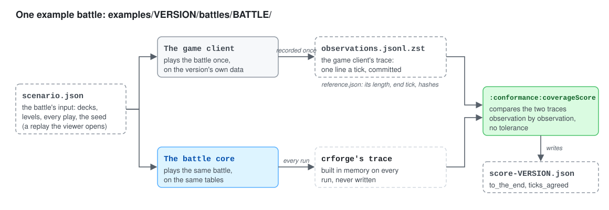

# Examples

`examples/<version>/` holds a few battles of one data version, each with the game's own trace of it: what the game shows on every tick of the battle. Hold the battle core to them, or open them in the replay viewer. The folder follows the data version the repository is locked to (`version=` in `crforge-data.lock`), today 16.635.8.

## The folder

The folder is laid out as a references folder, the layout the reference battles have ([conformance](../conformance/README.md)): one subfolder per battle under `battles/`, and listings under `corpora/` naming them.

| Path | Kind | What it is |
| --- | --- | --- |
| `16.635.8/` | Folder | Every example battle of data version 16.635.8: give this folder to `coverageScore` |
| `16.635.8/corpora/` | Folder | The listings |
| `16.635.8/corpora/replays.json` | File | Listing: the replays (`scripted_ladder`, `real_ladder`), recorded with schema v2 (the battle runs until the game stops it) |
| `16.635.8/corpora/generated.json` | File | Listing: the generated scenarios (`knight`), recorded with schema v1 (the battle runs a fixed number of ticks) |
| `16.635.8/battles/` | Folder | One subfolder per battle |
| `16.635.8/battles/<battle>/` | Folder | One battle |
| `16.635.8/battles/<battle>/scenario.json` | File | The battle's input: a replay file the viewer opens |
| `16.635.8/battles/<battle>/observations.jsonl.zst` | File | The game's trace of the battle: one observation a line, one line a tick, zstd-compressed |
| `16.635.8/battles/<battle>/reference.json` | File | The trace's length, where the game stopped the battle, and the SHA-256 of the trace and the scenario |

A listing holds the battles of one schema, so a new battle goes in as its own `battles/<battle>/` folder and one entry in the listing of its schema.

## The battles

| Battle | What it is | Ticks |
| --- | --- | --- |
| `scripted_ladder` | A whole Ladder battle the battle core plays with a fixed script (below) | 3051 |
| `real_ladder` | A Ladder battle two players played in the game, anonymized (below) | 2429 |
| `knight` | A generated scenario: one Knight played at tick 200 | 600 |

None of them holds a player's data. In `real_ladder` the players are named `Side 0` and `Side 1`, the account ids are made up, and the battle time, the players' progress and trophies, their banners, tower skins and emotes are removed. The account ids are battle inputs (each play names its side by its account, and an account id seeds the deck shuffle), so the made-up ids are ones that deal the same decks in the same order. Every other battle input is as played: the decks and levels, every play, the random seed, the mode, the arena and the season's event. The game's trace of the anonymized battle is the trace of the battle as played, observation for observation.

## Hold the battle core to them

Each battle's `scenario.json` drives both traces: the game client played it once, and its trace is the committed `observations.jsonl.zst`; the battle core plays it on every run and builds its own trace in memory, which `coverageScore` compares with the game client's and never writes.



From the repository root, on the tables of the folder's data version:

```bash
./gradlew :conformance:coverageScore -Pcrforge.assetSource=<source> -Pcrforge.dataVersion=16.635.8 -Pcrforge.coverage=$PWD/examples/16.635.8
```

The battle core plays every listed battle and compares it with the game's trace on every observation, with no tolerance. The score goes to `conformance/build/coverage/score-16.635.8.json`: `to_the_end` is the share of battles that match on every observation, `ticks_agreed` the share of ticks that match before each battle's first difference. On 16.635.8 all three match to the end.

## Watch one

```bash
./gradlew :desktop:run -Pcrforge.assetSource=<source> --args="--replay $PWD/examples/16.635.8/battles/scripted_ladder/scenario.json"
```

You can also drop a `scenario.json` on the window of the debug screen. See [Watching a replay](../README.md#watching-a-replay) for the keys and [Replays](../docs/architecture.md#replays) for the format.

## The scripted battle

`scripted_ladder` is played between the debug screen's two decks (`BattleDecks`: an evolution and two heroes on the blue side), with a fixed script for both sides (`org.crforge.desktop.replay.ExampleReplay`):

- each side waits until it has 9 elixir, then plays the first card of its hand it may play now
- a card that may be placed in the other side's half (a spell, the Miner) is aimed at the other side's tower nearest the side's lane; any other card is placed in that lane, 3 tiles in front of the side's princess tower there. Both sides use the same lane, the one at the low end of the arena's width, so their plays meet
- a hero's ability is used as soon as it may be
- the battle runs until its match is over

The file is a replay of one data version, the one the build made its tables of when it was written (its `capture` block names it). A data version bump writes it into the new version's folder:

```bash
./gradlew :desktop:exampleReplay -Pcrforge.assetSource=<source>
```

`ExampleReplayTest` fails while the file in the lock's version folder is not the battle the script plays on that version.

## A data version bump

The examples move to the new version with the lock: `:desktop:exampleReplay` writes the scripted battle into `examples/<new version>/`, the other battles' scenarios are carried over, the game's traces of all of them on the new version replace the old ones, and the old version's folder is removed. Each battle's listing entry names its scenario's SHA-256, so a scenario the bump changes needs its new trace.
